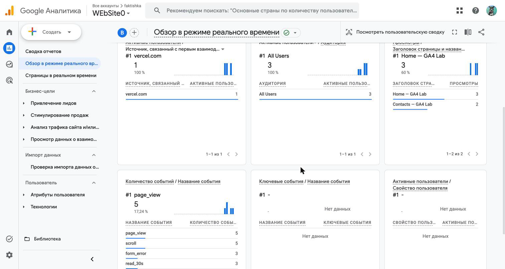
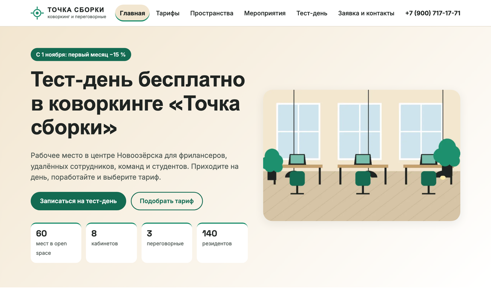

# funnel-project · ОП.03 «Информационные технологии»

Ваш репозиторий на всю дисциплину. Сюда вы сдаёте домашние работы: бланки
и скриншоты. Здесь же лежат конспекты лекций и файлы с занятий.
Репозиторий остаётся у вас и после окончания дисциплины.

## С чего начать

**1. Сделайте репозиторий своим.** Нажмите **Use this template → Create
a new repository** и назовите его `funnel-project`. Кнопка **Fork** для
этого не подходит: форк остаётся привязан к чужому репозиторию.

**2. Откройте его у себя.** Нужен только VS Code и аккаунт GitHub.
В редакторе: **Source Control → Clone Repository**, вставьте адрес своего
репозитория и выберите папку на диске. Как это выглядит по шагам —
[разбор с кадрами](docs/git/README.md#2-первый-репозиторий).

## Мои работы

**Студент:** Сдобников Андрей Андреевич, группа РПО 25/2.

Учебный сайт: [ga4-analytics-lab](https://github.com/dothefuture/ga4-analytics-lab) ·
[ga4-analytics-lab-two.vercel.app](https://ga4-analytics-lab-two.vercel.app) ·
Measurement ID `G-0DJ198TV26`. Все скриншоты в папках заданий — с моего сайта,
моего ресурса GA4, моей таблицы и моего аккаунта Instagram.

*Рис. 1. Realtime моего ресурса GA4 «WEbSite0»: просмотры страниц и свои события сайта.*

## Домашние работы

| № | Папка | Что сдаёте | Мой бланк | Кадры |
|---|---|---|---|---|
| 1 | `lesson_01` | три события на сайте, путь пользователя, точка потери данных | [homework_01.md](lesson_01/homework_01.md) | 2 |
| 2 | `lesson_02` | где бизнес теряет клиентов: воронка и настройка GA4 | [homework_02.md](lesson_02/homework_02.md) | 5 |
| 3 | `lesson_03` | скриншоты: тег на сайте, источник перехода и отчёты GA4 | [homework_03.md](lesson_03/homework_03.md) | 5 |
| 4 | `lesson_04` | четыре своих события на сайте и их параметры в GA4 | [homework_04.md](lesson_04/homework_04.md) | 4 |
| 5 | `lesson_05` | форма сайта пишет заявки в Google Таблицу через Apps Script | [homework_05.md](lesson_05/homework_05.md) | 9 |
| 6 | `lesson_06` | повторяемая очистка выгрузки заявок формулами Google Таблиц | [homework_06.md](lesson_06/homework_06.md) · [leads_clean.csv](lesson_06/leads_clean.csv) | 7 |
| 7 | `lesson_07` | цепочка Instagram → ManyChat → сайт → заявка в таблице | [homework_07.md](lesson_07/homework_07.md) | 7 из 8 |

Что делать по заданию, написано в файле `README.md` внутри папки задания.
Там же лежит бланк `homework_NN.md`: вы вписываете свои ответы в готовые
таблицы.

## Курсовая работа

Проект по техническому заданию компании в отдельном репозитории, описание
работы и защита презентацией до 7 минут. Порядок сдачи, шаблоны README
и описания, план слайдов — в [`kursovaya_rabota`](kursovaya_rabota/README.md).
Ссылки сдаются бланком `kursovaya_rabota/kursovaya.md`.

Моя курсовая — ТЗ № 17/2026, коворкинг «Точка сборки»:
[репозиторий](https://github.com/dothefuture/tz-17-kovorking-tochka-sborki) ·
[сайт](https://tz-17-kovorking-tochka-sborki.vercel.app) ·
[бланк сдачи](kursovaya_rabota/kursovaya.md).

*Рис. 2. Главная страница сайта курсовой «Точка сборки».*

## Лекции и материалы занятий

| Папка | Что внутри |
|---|---|
| [`lectures`](lectures/README.md) | конспект каждой темы: что разбирали на лекции, термины, что делали на занятии, что вошло в проект, ссылки на презентацию и документацию |
| [`materials`](materials/README.md) | файлы с занятий по папкам тем: стенды, код для сайта, CSV, шаблоны отчётов и чек-листы |

## Как сдать

Все работы сдаются в ветку `main`. Отдельную ветку и Pull Request для
задания создавать не нужно.

Заполняете бланк в папке задания, кладёте кадры в `screens/`, делаете
коммит с сообщением вида `hw-01: путь данных` и нажимаете **Sync Changes**.
После этого работа появляется на GitHub, и преподаватель проверяет её
в папке задания.

Всё это делается кнопками в VS Code, терминал не нужен:

| Что нужно | Где посмотреть |
|---|---|
| отобрать файлы и закоммитить | [изменения и коммиты](docs/git/README.md#3-изменения-и-коммиты) |
| отправить коммит на GitHub | [отправить на GitHub](docs/git/README.md#отправить-на-github) |
| забрать правки, сделанные на другом компьютере | [совместная работа](docs/git/README.md#8-совместная-работа-pull-и-fetch) |

Сроки, требования к скриншотам и чек-лист перед отправкой собраны
в [docs/SUBMIT.md](docs/SUBMIT.md).

## Что проверяется в любой работе

Шапка бланка заполнена, файл лежит в папке своего задания, скриншоты
в `screens/` и открываются по ссылкам из бланка, пустых строк-заготовок
не осталось, у источников записан полный адрес.

Полный список требований к оформлению лежит
в [HOMEWORK_TEMPLATE.md](HOMEWORK_TEMPLATE.md).

## Сайт для заданий 2–5 и 7

Для заданий 2, 3, 4, 5 и 7 понадобится свой сайт. Его код хранится
в отдельном репозитории: вы делаете копию шаблона
[ga4-analytics-lab](https://github.com/MaximBytecamp/ga4-analytics-lab)
и публикуете её на Vercel. В funnel-project код сайта не кладут, сюда сдаются
бланки и скриншоты.

## Чего здесь быть не должно

- Токены, ключи, пароли, строки подключения. Они хранятся в хранилище
  секретов сервиса.
- Экспорт workflow с секретами внутри: выгружайте очищенный.
- Лишние личные данные в тестовых заявках и на скриншотах.

Файл `.gitignore` исключает из коммитов файлы с частыми именами
(`*.secret`, `credentials*.json`, `.env`). Перед отправкой
просмотрите список изменений в коммите.

## Про ИИ

ИИ можно использовать для идей, структуры работы и формулировок. Источником
он не считается: под каждым фактом, цифрой и случаем нужна ссылка
на исходный материал. Наблюдения в браузере, настройку
сервисов и скриншоты вы делаете сами.

Показатели компаний придумывать нельзя. Если их нет в открытых
источниках, так и пишите: «точные показатели в открытом источнике
не приведены».

В каждом бланке есть строка об использовании ИИ: напишите, для чего он
использовался, или «не использовал». Работа без источников и своих
скриншотов не принимается.
