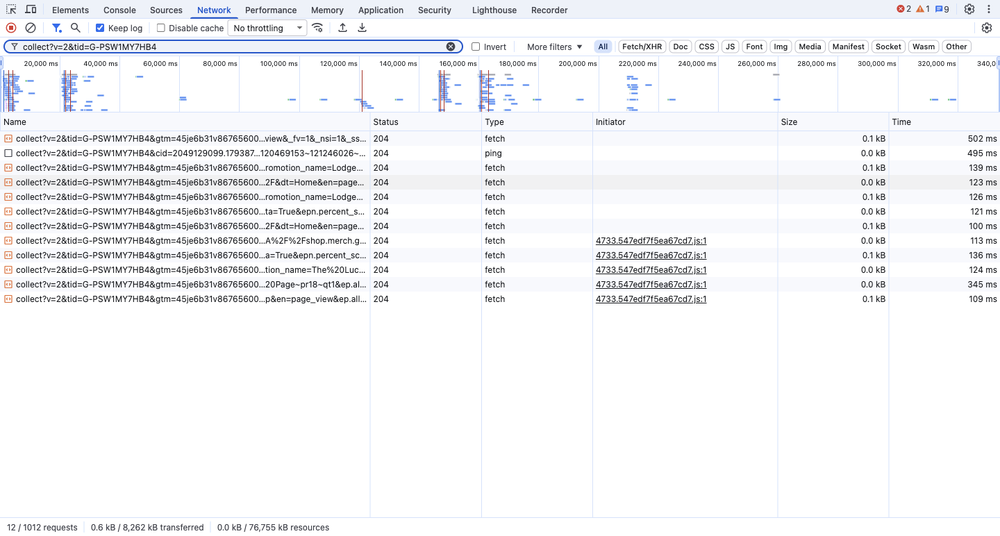
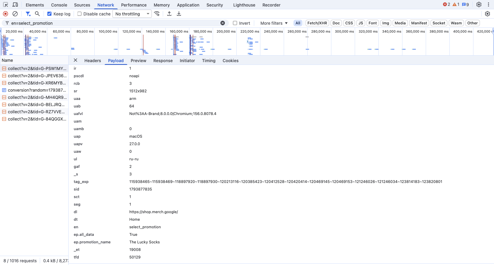

# Домашняя работа № 1 · Путь данных от ссылки до заявки

**Дисциплина:** ОП.03 «Информационные технологии»

| Поле | Значение |
|---|---|
| Фамилия, имя, отчество | Сдобников Андрей Андреевич |
| Группа | РПО 25/2 |
| Номер работы | 1 |
| Тема работы | Цифровая воронка: путь данных от ссылки до заявки |
| Дата сдачи | 05.11.2026 |

---

## 1. Какой сайт смотрел

| Поле | Значение |
|---|---|
| Название сайта | Google Merch Shop (официальный магазин мерча Google) |
| Адрес | https://shop.merch.google/ |
| Откуда сайт | из списка в задании |
| Браузер | Chromium 156, DevTools → Network, фильтр `collect`, галочка **Keep log** (в русской версии — Preserve log) |

## 2. Три действия и что отправил счётчик

На сайте стоит сразу несколько счётчиков GA4, поэтому одно действие
вызывает несколько одинаковых запросов `collect` с разными `tid`.
В таблице записан запрос счётчика `G-PSW1MY7HB4`.

| № | Что я сделал на сайте | Название события (`en`) | Что ещё было в Payload |
|---|---|---|---|
| 1 | обновил главную страницу | `page_view` | `dl` = `https://shop.merch.google/`, `dt` = `Home`, `cid` — номер посетителя, `sid` — номер сеанса |
| 2 | прокрутил главную до самого низа | `scroll` | `epn.percent_scrolled` — на сколько процентов прокручена страница |
| 3 | нажал на плитку «The Lucky Socks» → кнопка **Shop Socks** | `select_promotion` | `ep.promotion_name` = `The Lucky Socks`, `dl` = главная, где был клик. После перехода на `/shop/apparel/socks` ушли ещё `page_view` и `view_item_list` |

### Кадр 1 · Панель Network

> **Что на кадре.** Вкладка **Network**, включён **Keep log**, в фильтре
> `collect?v=2&tid=G-PSW1MY7HB4`: остались только хиты одного счётчика GA4.
> 12 строк из 1012 запросов страницы. Статус `204 No Content` — сервер
> аналитики принял событие и ничего не вернул, так и должно быть.
> В конце адресов видно `en=page_view`, `percent_scrolled`, `promotion_name=The Lucky…`.

### Кадр 2 · Вкладка Payload одного события

> **Что на кадре.** Запрос после клика по плитке: фильтр `en=select_promotion`,
> вкладка **Payload → Query string parameters**. Внизу списка:
> `dl` — адрес страницы, `dt` — её заголовок, **`en` = `select_promotion`**,
> `ep.promotion_name` = `The Lucky Socks` — параметр события (`ep.` —
> текстовый, `epn.` — числовой). Выше служебные поля: `tid` — счётчик,
> `cid` — посетитель, `sid` — сеанс, `ul` = `ru-ru` — язык браузера.

## 3. Путь пользователя: 5 шагов

Пример — покупатель приходит в Google Merch Shop из рассылки.

| № | Мой шаг | Какое событие это фиксирует |
|---|---|---|
| 1 | человек получил письмо-рассылку о новой коллекции и нажал на ссылку | на сайте — `page_view` с адресом из ссылки |
| 2 | открылась главная страница с баннерами коллекций | `page_view`, `view_promotion` |
| 3 | он нажал на плитку с носками и попал в каталог | `select_promotion`, `view_item_list` |
| 4 | открыл карточку товара и положил носки в корзину | `view_item`, `add_to_cart` |
| 5 | оформил заказ: ввёл адрес и оплатил | `begin_checkout`, `purchase` — заявка (заказ) уходит в магазин |

## 4. Где данные могут потеряться

| № | На каком шаге | Что может потеряться |
|---|---|---|
| 1 | шаг 1, переход из письма | если в ссылке письма нет UTM-меток, GA4 запишет визит как `(direct) / (none)`, и магазин не узнает, что покупателя привела рассылка |
| 2 | шаг 2, открытие сайта | баннер cookie: если человек нажал **Reject All**, часть счётчиков (рекламные `AW-…`) не отправит данные, и путь до покупки окажется неполным |

## 5. Использование ИИ

| Вопрос | Ответ |
|---|---|
| Что сделал сам | открыл сайт с DevTools, сделал три действия, нашёл запросы `collect` и прочитал Payload, выбрал шаги пути и точки потерь |
| Что спросил у модели | что означают служебные параметры `cid`, `sid`, `ep.` / `epn.` в запросе GA4 и как оформить бланк в Markdown |
| Что после этого изменил | дописал в пояснения к кадрам расшифровку параметров, проверив её по самому запросу |
