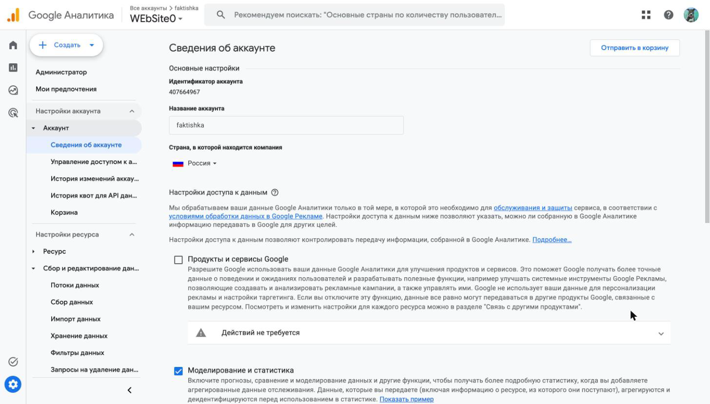
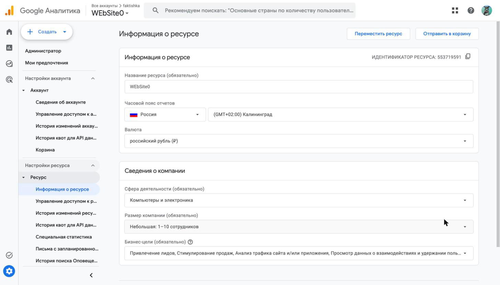
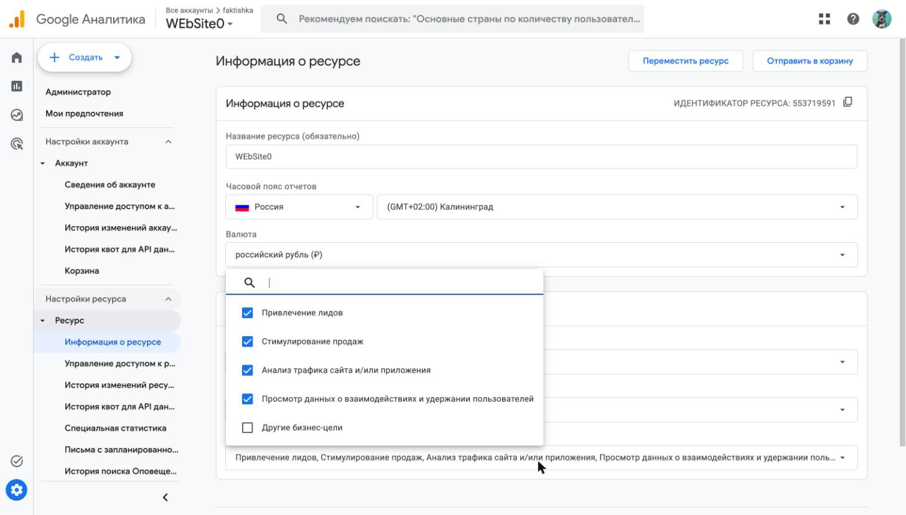
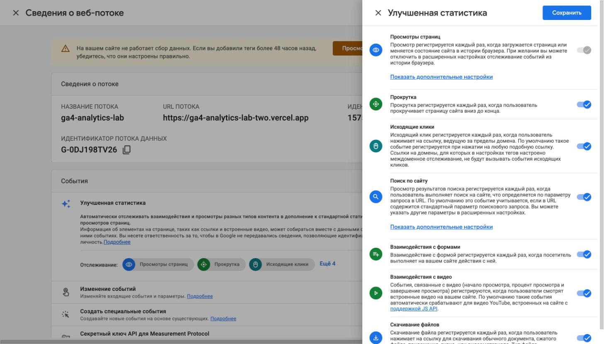
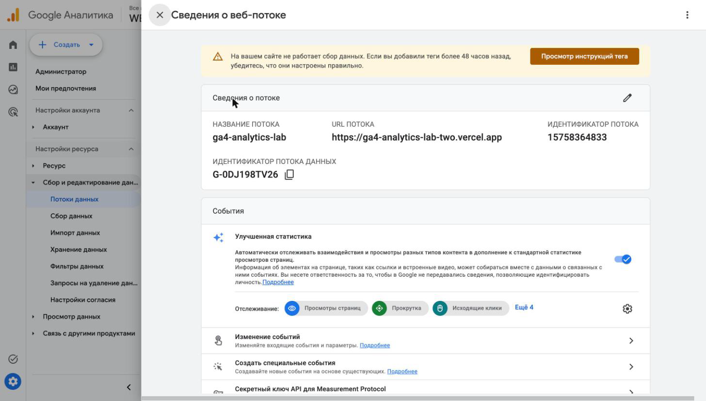

# Домашняя работа № 2 · Где бизнес теряет клиентов

**Дисциплина:** ОП.03 «Информационные технологии»

| Поле | Значение |
|---|---|
| Фамилия, имя, отчество | Сдобников Андрей Андреевич |
| Группа | РПО 25/2 |
| Номер работы | 2 |
| Тема работы | Анализ воронки цифрового продукта и структура Google Analytics 4 |
| Дата сдачи | 05.11.2026 |

---

# Часть 1. Исследование воронки

## 1.1. Объект исследования

| Поле | Значение |
|---|---|
| Компания, сервис или отрасль | Яндекс Практикум — онлайн-школа IT-профессий |
| Адрес сайта или приложения | https://practicum.yandex.ru/ |
| Целевое действие | заявка на курс «Бэкенд-разработчик» (оставить контакты для консультации) |
| Почему выбран этот объект | я сам выбираю, где учиться backend, и прошёл этот путь как пользователь; у школы длинная воронка с бесплатной частью, по ней хорошо видно, где люди отваливаются |

## 1.2. Воронка

| № | Этап | Что считается переходом дальше | Метрика этапа |
|---|---|---|---|
| 1 | Переход из рекламы или поиска | человек открыл страницу курса | сеансы на лендинге по источникам (`session_source`) |
| 2 | Изучение лендинга | прокрутил до программы и цены | доля сеансов с `scroll` 75 %+, время вовлечения |
| 3 | Бесплатная вводная часть | зарегистрировался и начал первый урок | регистрации / сеансы лендинга |
| 4 | Заявка на консультацию | отправил форму с контактами | `generate_lead` / сеансы лендинга |
| 5 | Разговор с менеджером | заявка получила статус «связались» | заявки со статусом `in_progress` / все заявки |
| 6 | Оплата | первый платёж за курс | оплаты / заявки |

## 1.3. Источники

### Источник 1

| Поле | Значение |
|---|---|
| Название материала | Cart Abandonment Rate Statistics |
| Автор или организация | Baymard Institute |
| Дата публикации | список обновляется регулярно, смотрел актуальную версию 05.11.2026 |
| Прямая ссылка | https://baymard.com/lists/cart-abandonment-rate |

**Выписка из материала:**

> Сводка 49 исследований: в среднем около 70 % людей, начавших оформление
> заказа, его бросают. Среди причин — непредвиденные расходы, обязательная
> регистрация, слишком длинная и сложная форма.

**Что подтверждает и как связано с моей воронкой:**

> Самая большая потеря происходит не на входе, а у самой формы. У Практикума
> это переход «лендинг → заявка» и «заявка → оплата»: если цену или
> рассрочку человек видит только в конце, он уходит.

**Цифры из источника и этап воронки:**

> ≈ 70 % брошенных оформлений → этапы 4 и 6.

### Источник 2

| Поле | Значение |
|---|---|
| Название материала | Find out how you stack up to new industry benchmarks for mobile page speed |
| Автор или организация | Think with Google (Google) |
| Дата публикации | февраль 2018 |
| Прямая ссылка | https://www.thinkwithgoogle.com/marketing-strategies/app-and-mobile/mobile-page-speed-new-industry-benchmarks/ |

**Выписка из материала:**

> 53 % посещений мобильного сайта обрываются, если страница грузится
> дольше трёх секунд.

**Что подтверждает и как связано с моей воронкой:**

> Часть людей теряется ещё на первом шаге, до того как увидит курс.
> Лендинг Практикума тяжёлый: видео, анимации. С рекламы в соцсетях почти
> все заходят с телефона.

**Цифры из источника и этап воронки:**

> 53 % отказов при загрузке дольше 3 с → этап 1.

### Источник 3

| Поле | Значение |
|---|---|
| Название материала | Website Forms Usability: Top 10 Recommendations |
| Автор или организация | Kathryn Whitenton, Nielsen Norman Group |
| Дата публикации | 03.04.2016 |
| Прямая ссылка | https://www.nngroup.com/articles/web-form-design/ |

**Выписка из материала:**

> Каждое лишнее поле увеличивает работу пользователя. Подписи должны стоять
> над полем, ошибки — рядом с полем и сразу понятны. Необязательные поля
> лучше убрать.

**Что подтверждает и как связано с моей воронкой:**

> На этапе заявки человек решает, стоит ли заполнять форму. Чем короче форма
> и чем понятнее ошибки, тем меньше людей уходит. В моём сайте это
> отслеживает событие `form_error`.

**Цифры из источника и этап воронки:**

> Числа в статье не приведены, это рекомендации по итогам юзабилити-тестов → этап 4.

### Источник 4

| Поле | Значение |
|---|---|
| Название материала | [GA4] Recommended events |
| Автор или организация | Справка Google Analytics |
| Дата публикации | дата не указана, справка обновляется |
| Прямая ссылка | https://support.google.com/analytics/answer/9267735 |

**Выписка из материала:**

> Для лидогенерации Google рекомендует событие `generate_lead`. Его можно
> отметить ключевым и считать по нему конверсию.

**Что подтверждает и как связано с моей воронкой:**

> Этап «заявка» можно измерить стандартным событием, а не придумывать своё.
> Тогда GA4 сам построит отчёт «Привлечение лидов».

**Цифры из источника и этап воронки:**

> Цифр нет, это описание события → этап 4.

### Источник 5

| Поле | Значение |
|---|---|
| Название материала | [GA4] Collect campaign data with custom URLs |
| Автор или организация | Справка Google Analytics |
| Дата публикации | дата не указана, справка обновляется |
| Прямая ссылка | https://support.google.com/analytics/answer/10917952 |

**Выписка из материала:**

> Параметры `utm_source`, `utm_medium` и `utm_campaign` в ссылке говорят GA4,
> откуда пришёл посетитель. Без них переход из письма или мессенджера
> попадает в `(direct) / (none)`.

**Что подтверждает и как связано с моей воронкой:**

> Если в ссылках из рекламы нет меток, первый этап воронки невозможно
> разложить по каналам, и непонятно, какой канал приводит людей, которые
> потом платят.

**Цифры из источника и этап воронки:**

> Цифр нет → этап 1.

## 1.4. Реальные кейсы

### Кейс 1

| № | Пункт | Ответ |
|---|---|---|
| 1 | Компания, продукт или рынок | российская онлайн-школа, продажа курсов через Telegram |
| 2 | Как выглядела воронка или её проблемный участок | заявка → разговор → оплата; люди оставляли заявку и пропадали до оплаты |
| 3 | В чём заключалась проблема | низкая конверсия из заявки в оплату — 8 % |
| 4 | Какие данные или наблюдения подтвердили проблему | подсчёт заявок и оплат по этапам воронки |
| 5 | Что изменили или протестировали | после заявки человек попадал в Telegram-воронку: серия сообщений с пользой и напоминаниями до оплаты |
| 6 | Как изменился результат | конверсия из заявки в оплату выросла с 8 % до 23 % |
| 7 | Переносим ли подход на мой объект | да: у Практикума между заявкой и оплатой тоже долгая пауза, её можно заполнить сообщениями в мессенджере |

**Ссылка на источник кейса:**

> https://workspace.ru/cases/konversiya-iz-zayavki-v-oplatu-vyrosla-s-8-do-23-telegram-voronka-dlya-onlayn-shkoly/

### Кейс 2

| № | Пункт | Ответ |
|---|---|---|
| 1 | Компания, продукт или рынок | российская онлайн-школа с потоком больше 1000 заявок в день |
| 2 | Как выглядела воронка или её проблемный участок | заявка → обработка менеджером |
| 3 | В чём заключалась проблема | заявки обрабатывались вручную и с задержкой, часть людей «остывала» |
| 4 | Какие данные или наблюдения подтвердили проблему | время реакции на заявку и доля необработанных заявок; точные показатели до изменений в открытом источнике не приведены |
| 5 | Что изменили или протестировали | автоматизировали приём и распределение заявок |
| 6 | Как изменился результат | конверсия выросла на 13 % |
| 7 | Переносим ли подход на мой объект | да: этап 5 моей воронки зависит от скорости звонка, а заявки уже приходят в таблицу со статусами |

**Ссылка на источник кейса:**

> https://workspace.ru/cases/avtomatizaciya-obrabotki-1000-zayavok-v-den-dlya-onlayn-shkoly-13-konversii/

## 1.5. Причины потери пользователей

| № | Этап воронки | Причина потери | Какой источник это подтверждает |
|---|---|---|---|
| 1 | 1 · переход | медленная загрузка лендинга на телефоне | Источник 2 (Think with Google) |
| 2 | 4 · заявка | длинная форма и непонятные ошибки в полях | Источник 3 (NN/g), Источник 1 (Baymard) |
| 3 | 5–6 · разговор и оплата | долгая пауза между заявкой и звонком, человек остывает | Кейсы 1 и 2 |

## 1.6. Гипотезы улучшения

| № | Этап | Гипотеза | Какие данные нужно собрать | Как проверить, сработало |
|---|---|---|---|---|
| 1 | 4 | Если оставить в форме только имя и контакт, доля отправленных форм вырастет | `form_error`, `generate_lead`, сеансы со страницы формы | сравнить `generate_lead` / сеансы за 2 недели до и после |
| 2 | 5 | Если звонить в первые 15 минут после заявки, больше людей дойдёт до разговора | время заявки и время смены статуса на `in_progress` в таблице | доля заявок в `in_progress` за сутки выросла |
| 3 | 1 | Если размечать все ссылки UTM, станет видно, какой канал приводит платящих | доля `(direct) / (none)` в отчёте «Привлечение трафика» | доля direct упала, по каждому каналу видно заявки |

---

# Часть 2. Google Analytics 4

## 2.1. Пройденные шаги

| № | Шаг | Выполнено |
|---|---|---|
| 1 | Вход в Google Analytics под своим аккаунтом | да |
| 2 | Создан Analytics Account | да |
| 3 | Создан Property | да |
| 4 | Выбраны часовой пояс, валюта и общие сведения | да |
| 5 | Выбраны бизнес-цели | да |
| 6 | Создан ресурс | да |
| 7 | Создан Web Data Stream | да |
| 8 | Проверены Website URL, Stream name, Enhanced Measurement | да |
| 9 | Поток создан | да |
| 10 | Найден Measurement ID | да |

## 2.2. Что получилось

| Поле | Значение |
|---|---|
| Analytics Account | `faktishka` (ID 407664967) |
| Property | `WEbSite0` (ID 553719591) |
| Reporting time zone | Россия, (GMT+02:00) Калининград |
| Currency | российский рубль (₽) |
| Выбранные бизнес-цели | привлечение лидов; стимулирование продаж; анализ трафика сайта; просмотр данных о взаимодействиях и удержании |
| Stream name | `ga4-analytics-lab` |
| Website URL | https://ga4-analytics-lab-two.vercel.app |
| Stream ID (числовой) | 15758364833 |
| Measurement ID (`G-…`) | `G-0DJ198TV26` |
| Enhanced Measurement | включено |

## 2.3. Скриншоты

### Кадр 1 · Analytics Account

> **Что на кадре.** «Администратор → Сведения об аккаунте»: название
> аккаунта `faktishka`, идентификатор 407664967, страна — Россия. Ниже
> настройки доступа к данным: передача в продукты Google выключена,
> «Моделирование и статистика» включено.

### Кадр 2 · Ресурс: часовой пояс и валюта

> **Что на кадре.** «Информация о ресурсе» `WEbSite0`, идентификатор
> 553719591. Часовой пояс отчётов — Калининград (GMT+2), валюта — рубль.
> Сфера деятельности — «Компьютеры и электроника», размер — 1–10 сотрудников.

### Кадр 3 · Бизнес-цели

> **Что на кадре.** Раскрыт список бизнес-целей, отмечены четыре. От них
> зависит, какие наборы отчётов GA4 покажет слева: у меня появились
> «Привлечение лидов» и «Стимулирование продаж».

### Кадр 4 · Веб-поток

> **Что на кадре.** Сведения о потоке: имя `ga4-analytics-lab`, URL
> `https://ga4-analytics-lab-two.vercel.app`. Справа открыта «Улучшенная
> статистика»: просмотры, прокрутка, исходящие клики, поиск, формы, видео
> и скачивания включены. Эти события GA4 собирает без своего кода.

### Кадр 5 · Measurement ID

> **Что на кадре.** Идентификатор потока `15758364833` (число) и
> идентификатор потока данных `G-0DJ198TV26`: его я ставлю в тег на сайте.
> Жёлтая плашка «сбор данных не работает» висела в момент создания потока,
> пока тег ещё не стоял.

---

## Использование ИИ

| Вопрос | Ответ |
|---|---|
| Что сделано самостоятельно | выбрал объект, прошёл путь до заявки на сайте школы, составил воронку, нашёл и прочитал источники и кейсы, создал ресурс и поток в GA4, снял кадры |
| Что спрошено у модели | как сформулировать метрику для каждого этапа и чем Stream ID отличается от Measurement ID |
| Что после этого проверено и изменено | метрики переписал под события, которые реально есть в GA4; разницу ID сверил по экрану потока |
