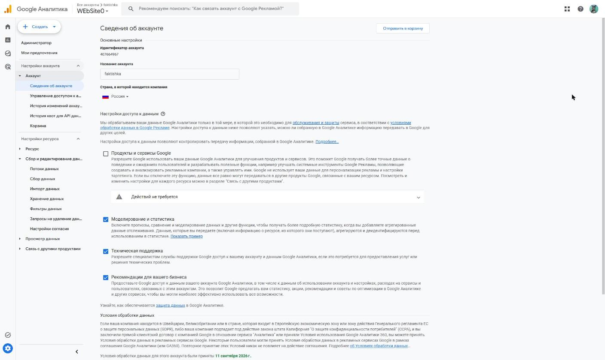
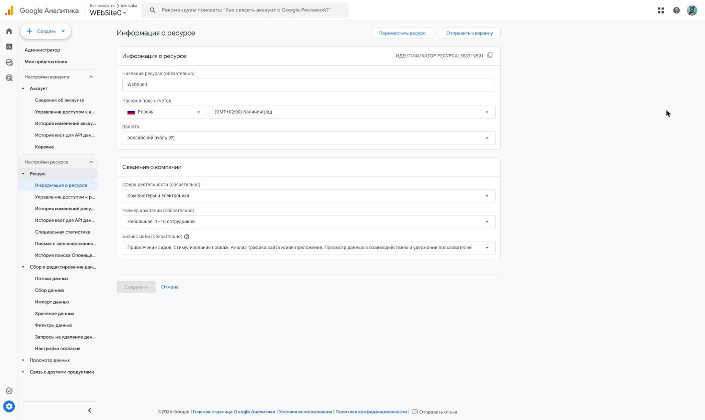
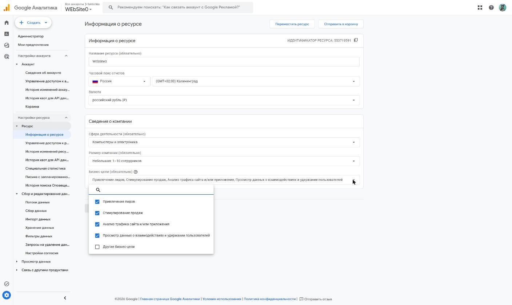
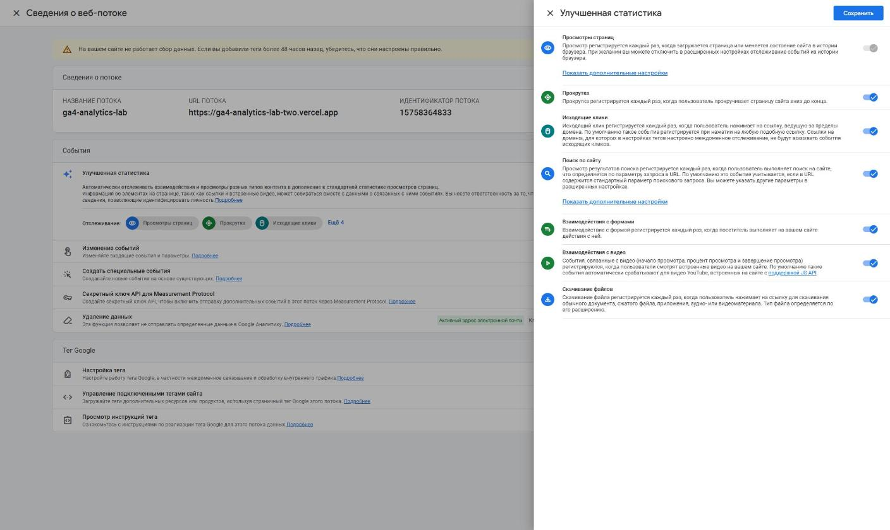
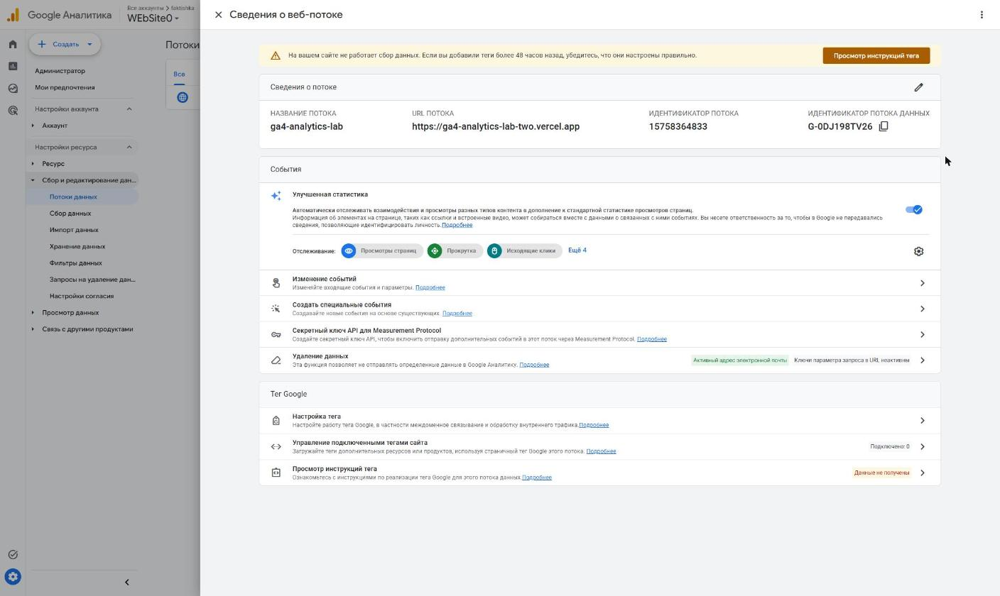

# Домашняя работа № 2 · Где бизнес теряет клиентов

**Дисциплина:** ОП.03 «Информационные технологии»

| Поле | Значение |
|---|---|
| Фамилия, имя, отчество | Сдобников Андрей Андреевич |
| Группа | РПО-2 |
| Номер работы | 2 |
| Тема работы | Анализ воронки цифрового продукта и структура Google Analytics 4 |
| Дата сдачи | 22.10.2026 |

---

# Часть 1. Исследование воронки

## 1.1. Объект исследования

| Поле | Значение |
|---|---|
| Компания, сервис или отрасль | Российские интернет-магазины непродовольственных товаров (e-commerce) |
| Адрес сайта или приложения | отрасль, не один сайт; примеры площадок — в кейсах ниже |
| Целевое действие | оплаченный заказ |
| Почему выбран этот объект | по отрасли есть открытые исследования с цифрами по каждому шагу оформления заказа, а путь «реклама → карточка → корзина → оплата» хорошо измеряется в GA4 и Метрике |

## 1.2. Воронка

| № | Этап | Что считается переходом дальше | Метрика этапа |
|---|---|---|---|
| 1 | Переход из рекламы или соцсетей на сайт | открыта страница сайта с UTM-метками | сеансы по источнику (`session_source / medium`), показатель отказов |
| 2 | Просмотр карточки товара | открыта страница товара | доля сеансов с `view_item` |
| 3 | Добавление в корзину | товар положен в корзину | конверсия в `add_to_cart` |
| 4 | Оформление заказа | начато оформление: контакты, доставка | доля корзин с `begin_checkout`, доля брошенных корзин |
| 5 | Оплата | заказ оплачен | конверсия в `purchase`, доля неоплаченных заказов |

## 1.3. Источники

### Источник 1

| Поле | Значение |
|---|---|
| Название материала | 70% товаров в российских интернет-магазинах покупатели не оплачивают |
| Автор или организация | ComNews; исследование Tinkoff eCommerce |
| Дата публикации | 28.11.2023 |
| Прямая ссылка | https://www.comnews.ru/content/230424/2023-11-28/2023-w48/1010/70-tovarov-rossiyskikh-internet-magazinakh-pokupateli-ne-oplachivayut |

**Выписка из материала** (ключевая мысль, цифра, наблюдение, результат):

> Более 70% собранных российскими интернет-магазинами заказов остаются
> не оплаченными. Выборка — 321 интернет-магазин и более 1000 покупателей.
> 94% покупателей признались, что бросали корзины.

**Что подтверждает и как связано с моей воронкой** (своими словами):

> Самая большая потеря в отрасли — между корзиной и оплатой (этапы 4–5).
> Значит, анализ стоит начинать не с рекламы, а с оформления заказа.

**Цифры из источника и этап воронки, к которому относятся:**

> Этап 4 (оформление): несколько экранов — 71%, много обязательных полей — 65%,
> лишние персональные данные — 58%. Доставка: стоимость — 78%, скорость — 65%.
> Этап 5 (оплата): нет оплаты при получении — 59%, долгий ввод карты — 59%,
> недоверие — 30%. Неоплаченные заказы по категориям: садоводство 91%,
> гейминг 30%.

### Источник 2

| Поле | Значение |
|---|---|
| Название материала | 50 Cart Abandonment Rate Statistics 2026 – Cart & Checkout |
| Автор или организация | Baymard Institute |
| Дата публикации | обновлено 22.09.2025 |
| Прямая ссылка | https://baymard.com/lists/cart-abandonment-rate |

**Выписка из материала:**

> Средняя доля брошенных корзин — 70,22% по 50 исследованиям. Среди причин
> (без «просто смотрел»): высокие доп. расходы — 40%, медленная доставка — 20%,
> недоверие к сайту с картой — 19%, обязательная регистрация — 18%, долгое
> или сложное оформление — 17%.

**Что подтверждает и как связано с моей воронкой:**

> Международные данные совпадают с российскими: около 70% корзин не доходят
> до оплаты, а причины те же — цена доставки, регистрация, сложная форма.
> Это не особенность одного рынка, а общая слабая точка этапа 4.

**Цифры из источника и этап воронки:**

> Этап 4–5: 70,22% брошенных корзин; по оценке Baymard, крупный магазин может
> поднять конверсию на 35,26% только за счёт улучшения оформления заказа.

### Источник 3

| Поле | Значение |
|---|---|
| Название материала | Каждая вторая брошенная корзина становится заказом — данные RetailCRM |
| Автор или организация | RetailCRM, блог Дмитрия Бороздина на Sostav |
| Дата публикации | 15.05.2026 |
| Прямая ссылка | https://www.sostav.ru/blogs/285372/86727 |

**Выписка из материала:**

> В I квартале 2026 года брошено 88% корзин (год назад — 85%). Около 46%
> брошенных корзин всё же превращаются в заказ; средний срок от брошенной
> корзины до заказа сократился с 7 до 2 дней.

**Что подтверждает и как связано с моей воронкой:**

> Брошенная корзина — не всегда потерянный клиент: почти половина
> возвращается. Значит, между этапами 3 и 5 нужно мерить не только отказ,
> но и возврат, и работать с напоминаниями.

**Цифры из источника и этап воронки:**

> Этап 3 → 5: 88% брошенных корзин, 46% из них конвертируются в заказ,
> средний срок — 2 дня. Размер выборки в материале не указан.

### Источник 4

| Поле | Значение |
|---|---|
| Название материала | Опросили 1000 пользователей о недочётах в интерфейсах, которые осложняют им процесс совершения покупок в интернете |
| Автор или организация | KISLOROD совместно с сервисом AskUsers, блог на Sostav |
| Дата публикации | 11.11.2025 |
| Прямая ссылка | https://www.sostav.ru/blogs/285125/70939 |

**Выписка из материала:**

> 67% клиентов уходят с сайта, если не находят данных о наличии товара;
> 68% считают информацию о составе товара критически важной; 48% называют
> обязательную регистрацию перед оплатой серьёзным препятствием.

**Что подтверждает и как связано с моей воронкой:**

> Часть потерь происходит раньше корзины — на карточке товара (этап 2),
> если на ней нет наличия и состава. Регистрация перед оплатой снова
> названа барьером, как у Baymard.

**Цифры из источника и этап воронки:**

> Этап 2: 67% (нет наличия), 68% (нет состава). Этап 4: 48% (регистрация).

### Источник 5

| Поле | Значение |
|---|---|
| Название материала | Исследование: как покупают онлайн до и во время пандемии |
| Автор или организация | Data Insight и оргкомитет IDRF'2020, публикация Retail.ru |
| Дата публикации | 24.04.2020 |
| Прямая ссылка | https://www.retail.ru/rbc/pressreleases/24ttl-issledovanie-kak-pokupayut-onlayn-do-i-vo-vremya-pandemii/ |

**Выписка из материала:**

> Опрос 500 жителей Москвы и Санкт-Петербурга 18–44 лет. Главным
> преимуществом онлайн-покупок названо удобство выбора и поиска — почти
> вдвое чаще, чем низкая цена; главный сдерживающий фактор — необходимость
> увидеть товар вживую.

**Что подтверждает и как связано с моей воронкой:**

> Покупателя удерживает удобный поиск и выбор (этапы 1–2), а теряет
> невозможность «увидеть товар» — это закрывается подробной карточкой:
> фото, состав, наличие.

**Цифры из источника и этап воронки:**

> Этап 1–2: до пандемии 43% покупали онлайн чаще раза в месяц, за первые
> 2 недели пандемии онлайн-покупку сделали более 80%. Проценты по
> сдерживающим факторам в открытом источнике не приведены.

## 1.4. Реальные кейсы

### Кейс 1

| № | Пункт | Ответ |
|---|---|---|
| 1 | Компания, продукт или рынок | VCLAND — интернет-магазин запчастей и аксессуаров к электронике; подрядчик — агентство «Оптимизм» |
| 2 | Как выглядела воронка или её проблемный участок | путь «карточка товара → корзина → оформление заказа» не был размечен целями в аналитике |
| 3 | В чём заключалась проблема | магазин не видел, на каком шаге покупки теряются клиенты: счётчики стояли, но цели оформления заказа отсутствовали |
| 4 | Какие данные или наблюдения подтвердили проблему | аудит счётчиков и целей; конкретные цифры до работ в открытом источнике не приведены |
| 5 | Что изменили или протестировали | проверили установку счётчиков, добавили цели на оформление заказа, настроили электронную торговлю и отслеживание каждого шага покупки, упростили оформление и доработали карточки товаров |
| 6 | Как изменился результат | конверсия в покупателей выросла на 34%, звонков стало в 1,5 раза больше, сообщений из чата — в 3 раза больше; базовые значения и период в источнике не указаны |
| 7 | Переносим ли подход на мой объект | да: сначала разметить этапы 2–5 событиями (`view_item`, `add_to_cart`, `begin_checkout`, `purchase`), потом упрощать шаг с наибольшей потерей |

**Ссылка на источник кейса:**

> https://ruward.ru/cases/5707/ (кейс агентства «Оптимизм», 19.06.2023)

### Кейс 2

| № | Пункт | Ответ |
|---|---|---|
| 1 | Компания, продукт или рынок | интернет-магазин БАДов с доставкой по России (название в источнике не указано); подрядчик — МАКО DIGITAL |
| 2 | Как выглядела воронка или её проблемный участок | корзина → форма заявки: в форму была встроена длинная медицинская анкета |
| 3 | В чём заключалась проблема | посетители начинали заполнять форму и бросали её; меню перегружено, корзина не закреплена, условия доставки спрятаны в подвал |
| 4 | Какие данные или наблюдения подтвердили проблему | конверсия в заказ 0,67%; 52% корзин бросали после начала заполнения формы |
| 5 | Что изменили или протестировали | вынесли анкету из заявки в отдельный тест со скидкой, сделали трёхуровневое меню, закрепили меню с корзиной, вынесли доставку в служебное меню, добавили «Избранное» |
| 6 | Как изменился результат | конверсия в заказ выросла с 0,67% до 2,2%, доля брошенных корзин снизилась с 52% до 11% |
| 7 | Переносим ли подход на мой объект | да: сократить обязательные поля формы оформления до минимума и не собирать данные, которые не нужны для доставки — это прямо совпадает с 65% и 58% из источника 1 |

**Ссылка на источник кейса:**

> https://habr.com/ru/articles/822317 (МАКО DIGITAL, Хабр, 25.06.2024)

## 1.5. Причины потери пользователей

| № | Этап воронки | Причина потери | Какой источник это подтверждает |
|---|---|---|---|
| 1 | 4. Оформление заказа | слишком много экранов и обязательных полей, лишние персональные данные | источник 1 (71%, 65%, 58%), кейс 2 |
| 2 | 4–5. Доставка и оплата | дорогая или медленная доставка, нет оплаты при получении | источник 1 (78%, 65%, 59%), источник 2 (40%, 20%) |
| 3 | 4. Оформление заказа | обязательная регистрация перед оплатой | источник 2 (18%), источник 4 (48%) |
| 4 | 2. Карточка товара | нет данных о наличии и составе товара | источник 4 (67%, 68%), источник 5 |

## 1.6. Гипотезы улучшения

| № | Этап | Гипотеза | Какие данные нужно собрать | Как проверить, сработало |
|---|---|---|---|---|
| 1 | 4 | Если собрать оформление на одной странице и оставить только поля, нужные для доставки, доля брошенных корзин снизится | события `begin_checkout`, `add_shipping_info`, `add_payment_info`, `purchase`; ошибки валидации полей | A/B-тест на 2 недели: доля сеансов с `purchase` среди сеансов с `begin_checkout` в тестовой группе выше контрольной |
| 2 | 4 | Если разрешить заказ без регистрации (гостевой заказ), больше людей дойдёт до оплаты | доля заказов гостей и зарегистрированных, отказы на шаге регистрации | сравнить конверсию `begin_checkout → purchase` за 2 недели до и после изменения, при похожем объёме трафика |
| 3 | 2 | Если показывать на карточке наличие и срок доставки до добавления в корзину, вырастет доля добавлений и снизятся отказы на оформлении из-за доставки | `view_item`, `add_to_cart`, клики по блоку доставки, причины отказа из опроса на выходе | рост доли `add_to_cart` среди `view_item` и падение доли брошенных корзин в A/B-тесте |

---

# Часть 2. Google Analytics 4

## 2.1. Пройденные шаги

| № | Шаг | Выполнено |
|---|---|---|
| 1 | Вход в Google Analytics под своим аккаунтом | да |
| 2 | Создан Analytics Account | да |
| 3 | Создан Property | да |
| 4 | Выбраны часовой пояс, валюта и общие сведения | да |
| 5 | Выбраны бизнес-цели | да |
| 6 | Создан ресурс | да |
| 7 | Создан Web Data Stream | да |
| 8 | Проверены Website URL, Stream name, Enhanced Measurement | да |
| 9 | Поток создан | да |
| 10 | Найден Measurement ID | да |

## 2.2. Что получилось

| Поле | Значение |
|---|---|
| Analytics Account | `faktishka` (ID 407664967), страна — Россия |
| Property | `WEbSite0` (ID 553719591) |
| Reporting time zone | Россия, (GMT+02:00) Калининград |
| Currency | российский рубль (₽) |
| Выбранные бизнес-цели | привлечение лидов; стимулирование продаж; анализ трафика сайта и/или приложения; просмотр данных о взаимодействиях и удержании пользователей |
| Stream name | `ga4-analytics-lab` |
| Website URL | https://ga4-analytics-lab-two.vercel.app |
| Stream ID (числовой) | 15758364833 |
| Measurement ID (`G-…`) | `G-0DJ198TV26` |
| Enhanced Measurement | включено |

Stream ID и Measurement ID — это разные идентификаторы. На сайт в задании 3
ставится второй, вида `G-XXXXXXXXXX`.

Кадры сняты в настройках уже созданных аккаунта, ресурса и потока
(Администратор → Сведения об аккаунте / Информация о ресурсе / Потоки
данных): там видны те же значения, что выбирались при создании.

## 2.3. Скриншоты

---

## Использование ИИ

| Вопрос | Ответ |
|---|---|
| Что сделано самостоятельно | настройка аккаунта, ресурса и потока GA4; выбор объекта и построение воронки |
| Что спрошено у модели | поиск открытых исследований и кейсов по брошенным корзинам, помощь со структурой таблиц |
| Что после этого проверено и изменено | каждая цифра и дата сверены с первоисточником по ссылке; цифры без методики помечены |
