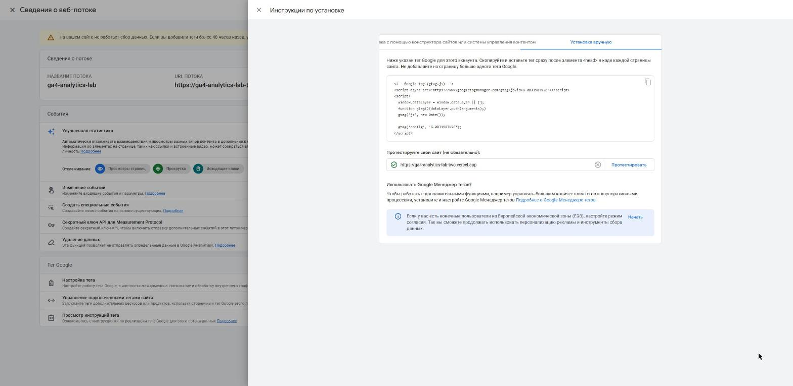
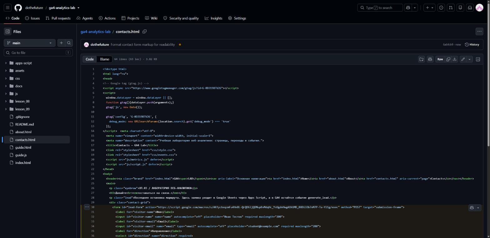
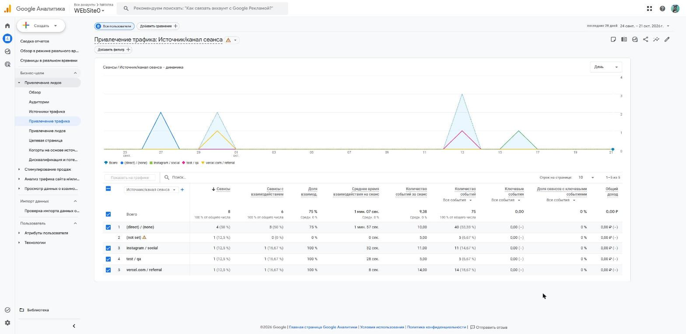
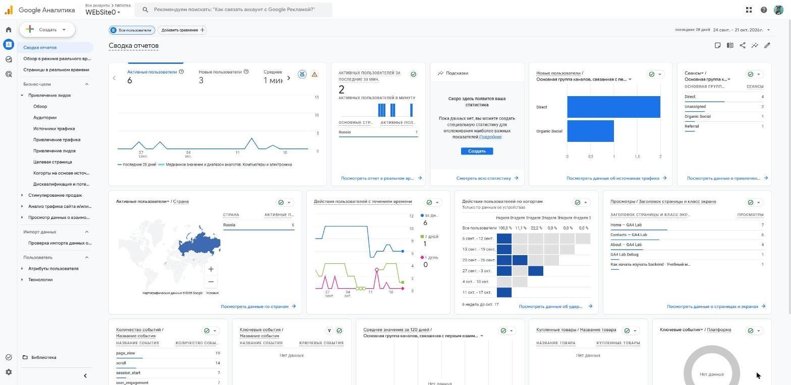

# Домашняя работа № 3 · Тег на сайте, источник и отчёты GA4

**Дисциплина:** ОП.03 «Информационные технологии»

| Поле | Значение |
|---|---|
| Фамилия, имя, отчество | Сдобников Андрей Андреевич |
| Группа | РПО-2 |
| Номер работы | 3 |
| Тема работы | Установка Google Tag, источник перехода и отчёты GA4 |
| Дата сдачи | 22.10.2026 |

---

## 1. Мой сайт и мой ресурс

| Поле | Значение |
|---|---|
| Адрес репозитория сайта | https://github.com/dothefuture/ga4-analytics-lab |
| Публичный адрес сайта | https://ga4-analytics-lab-two.vercel.app/ |
| Статус публикации | READY |
| Analytics Account | `faktishka` (ID 407664967) |
| Property | `WEbSite0` (ID 553719591) |
| Stream name | `ga4-analytics-lab` |
| Website URL в потоке | https://ga4-analytics-lab-two.vercel.app |
| Measurement ID (`G-…`) | `G-0DJ198TV26` |
| Страницы с тегом | `index.html`, `about.html`, `contacts.html`, `guide.html` — по одному тегу сразу после `<head>` |

Тег ставится на каждую страницу по одному разу: две копии дают двойные
события.

## 2. Тег установлен

**Результат проверки из инструкции тега:**

> «Инструкции по установке → Установка вручную → Протестируйте свой сайт»:
> для адреса `https://ga4-analytics-lab-two.vercel.app` проверка прошла,
> рядом с адресом зелёная галочка — тег Google на сайте обнаружен.





## 3. События доходят до аналитики

| Поле | Значение |
|---|---|
| Дата и время проверки | 22.10.2026, 00:10–00:16 (часовой пояс ресурса GMT+02:00) |
| Какие страницы открывали | Home, About, Contacts |
| Какие события появились в Realtime | `page_view`, `scroll`, `form_start`, `form_submit`, `form_error`, `generate_lead`, `nav_click`, `utm_visit`, `cta_click`, `read_30s`, `first_visit`, `session_start`, `user_engagement` |
| Число активных пользователей в момент проверки | 1 |


## 4. Источник перехода определился

Ссылка собирается с метками `utm_source`, `utm_medium`, `utm_campaign`
и открывается на своём сайте.

**Ссылка целиком:**

```
https://ga4-analytics-lab-two.vercel.app/guide.html?utm_source=instagram&utm_medium=social&utm_campaign=backend_guide
```

| Поле | Значение |
|---|---|
| Где в GA4 виден источник | Отчёты → Привлечение лидов → Привлечение трафика, измерение «Источник/канал сеанса», период 24 сент. – 21 окт. 2026 |
| Какое значение источника показал GA4 | `instagram / social` (1 сеанс), канал Organic Social |
| Совпадает с `utm_source` из ссылки | да |



Переход 22.10.2026 по ссылке с `utm_source=telegram&utm_medium=social`
пока виден только в DebugView (событие `utm_visit`, source = `telegram`).
В стандартные отчёты он попадёт после обработки данных, в течение суток.

## 5. Статистика на странице «Отчёты»

| Показатель | Значение | Период |
|---|---|---|
| Пользователи | 6 активных, из них 3 новых | 24 сент. – 21 окт. 2026 |
| Сеансы | 8 | 24 сент. – 21 окт. 2026 |
| События | 75 | 24 сент. – 21 окт. 2026 |
| Самое частое событие | `page_view` — 19 | 24 сент. – 21 окт. 2026 |



**Что видно по этим числам** (2–3 предложения):

> Трафик учебный и небольшой: 6 пользователей за 4 недели, всплески
> совпадают с днями занятий (27.09, 29.09, 13.10, 16.10). Половина сеансов —
> прямые заходы, остальные пришли по размеченным ссылкам (instagram, test)
> и с vercel.com. На один сеанс приходится около 9 событий: посетители
> не только открывают страницу, но и ходят по сайту и нажимают кнопки.

## 6. Что не получилось

> В потоке был указан URL `…/contacts.html` вместо корня сайта — исправил
> на `https://ga4-analytics-lab-two.vercel.app`. На сбор данных это
> не влияло: поток принимает данные по Measurement ID, а не по URL.

## 7. Использование ИИ

| Вопрос | Ответ |
|---|---|
| Что сделано самостоятельно | установка тега на страницы, публикация на Vercel, проверка тега, Realtime и отчёты в своём ресурсе |
| Что спрошено у модели | помощь со снятием кадров и оформлением бланка |
| Что после этого изменено | значения в бланке сверены с кадрами из своего ресурса GA4 |
