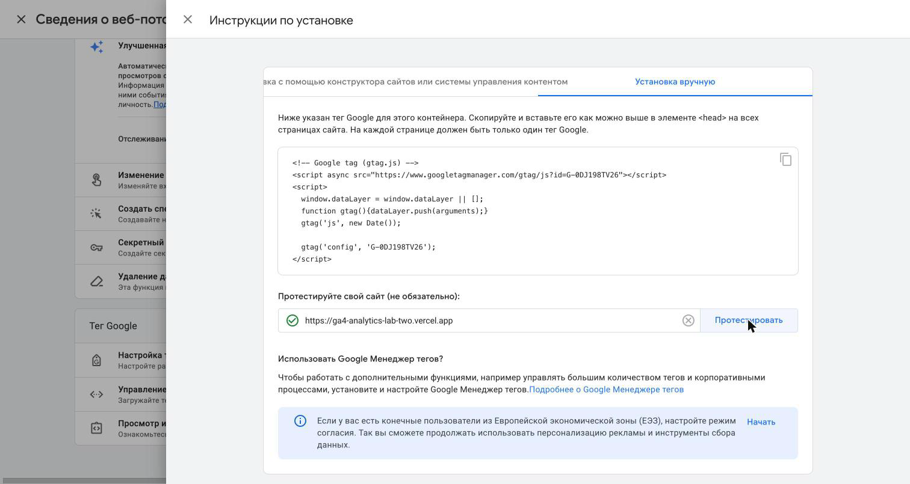
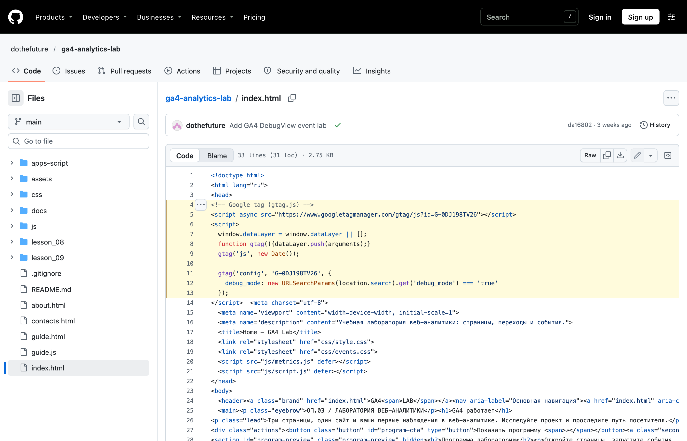
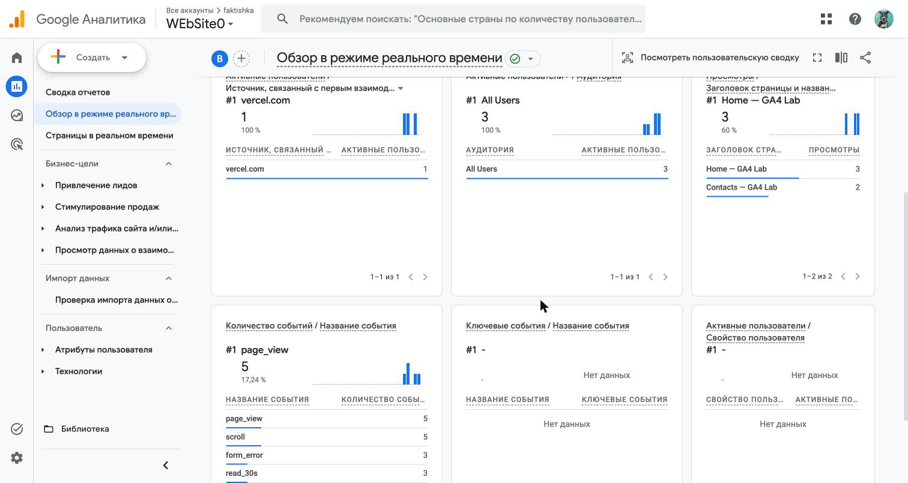
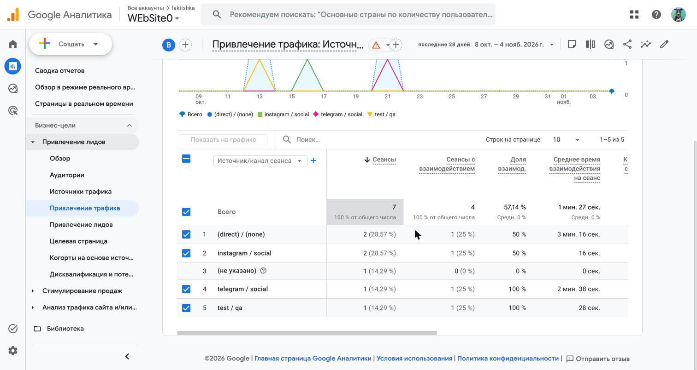
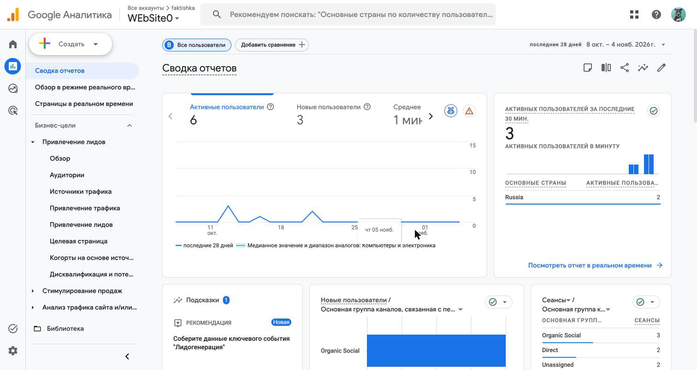

# Домашняя работа № 3 · Тег на сайте, источник и отчёты GA4

**Дисциплина:** ОП.03 «Информационные технологии»

| Поле | Значение |
|---|---|
| Фамилия, имя, отчество | Сдобников Андрей Андреевич |
| Группа | РПО 25/2 |
| Номер работы | 3 |
| Тема работы | Установка Google Tag, источник перехода и отчёты GA4 |
| Дата сдачи | 05.11.2026 |

---

## 1. Мой сайт и мой ресурс

| Поле | Значение |
|---|---|
| Адрес репозитория сайта | https://github.com/dothefuture/ga4-analytics-lab |
| Публичный адрес сайта | https://ga4-analytics-lab-two.vercel.app |
| Статус публикации | READY |
| Analytics Account | `faktishka` |
| Property | `WEbSite0` |
| Stream name | `ga4-analytics-lab` |
| Website URL в потоке | https://ga4-analytics-lab-two.vercel.app |
| Measurement ID (`G-…`) | `G-0DJ198TV26` |
| Страницы с тегом | `index.html`, `about.html`, `contacts.html`, `guide.html` — по одному тегу в `<head>` |

## 2. Тег установлен

**Результат проверки из инструкции тега:**

> «Инструкции по установке → Установка вручную → Протестировать»: у адреса
> `https://ga4-analytics-lab-two.vercel.app` загорелась зелёная галочка —
> тег Google на сайте найден.

### Кадр 1 · Проверка тега



> **Что на кадре.** Окно «Инструкции по установке», вкладка «Установка
> вручную». Сверху код тега с моим `G-0DJ198TV26`, ниже поле «Протестируйте
> свой сайт» с адресом сайта и зелёной галочкой — проверка прошла.

### Кадр 2 · Тег в коде



> **Что на кадре.** `index.html` в моём репозитории на GitHub. Строки 4–13
> подсвечены: это тег `gtag.js` с `G-0DJ198TV26`. Он стоит сразу после
> `<head>`, как требует инструкция. В `config` добавлен `debug_mode`: он
> включается параметром `?debug_mode=true` в адресе и нужен для DebugView
> в задании 4.

## 3. События доходят до аналитики

| Поле | Значение |
|---|---|
| Дата и время проверки | 05.11.2026, около 14:40 (МСК) |
| Какие страницы открывали | `Home — GA4 Lab` (главная), `Contacts — GA4 Lab` |
| Какие события появились в Realtime | `page_view` 5, `scroll` 5, `form_error` 3, `read_30s` 3 |
| Число активных пользователей в момент проверки | 3 |

### Кадр 3 · Realtime



> **Что на кадре.** «Обзор в режиме реального времени». В карточке событий
> первым идёт `page_view` — 5 штук. Справа видно, какие страницы смотрели:
> Home 3 раза, Contacts 2 раза. Активных пользователей — 3.

## 4. Источник перехода определился

**Ссылка целиком:**

```
https://ga4-analytics-lab-two.vercel.app/?utm_source=telegram&utm_medium=social&utm_campaign=ga4_lab
```

| Поле | Значение |
|---|---|
| Где в GA4 виден источник | Отчёты → Привлечение лидов → Привлечение трафика, измерение «Источник/канал сеанса» |
| Какое значение источника показал GA4 | `telegram / social` |
| Совпадает с `utm_source` из ссылки | да |

### Кадр 4 · Источник перехода



> **Что на кадре.** Отчёт «Привлечение трафика» за 8 октября — 4 ноября.
> Всего 7 сеансов. Строка 4 — `telegram / social`: это мой переход по ссылке
> выше. Ещё видны `instagram / social` (проверка из задания 7),
> `(direct) / (none)` и тестовый `test / qa`.

## 5. Статистика на странице «Отчёты»

| Показатель | Значение | Период |
|---|---|---|
| Пользователи | 6 активных, из них 3 новых | 08.10.2026 – 04.11.2026 |
| Сеансы | 7 | 08.10.2026 – 04.11.2026 |
| События | в карточке сводки не выводится; в Realtime за 30 минут — 29 событий | 05.11.2026 |
| Самое частое событие | `page_view` | 05.11.2026 |

### Кадр 5 · Сводка отчётов



> **Что на кадре.** «Сводка отчётов» за последние 28 дней: 6 активных
> пользователей, 3 новых. На графике пики в дни, когда я проверял сайт.
> Справа: за последние 30 минут 3 активных пользователя, страна — Russia.
> Внизу каналы: Organic Social 3 сеанса, Direct 2, Unassigned 2.

**Что видно по этим числам:**

> Сайт учебный, поэтому посетители — это я и мои проверки с разных
> устройств. Зато видно, что метки работают: переходы из Telegram
> и Instagram попали в Organic Social, а не в Direct. Сеансы без меток GA4
> честно записал как Direct или Unassigned.

## 6. Что не получилось

> Всё получилось.

## 7. Использование ИИ

| Вопрос | Ответ |
|---|---|
| Что сделано самостоятельно | вставил тег на все страницы, опубликовал сайт на Vercel, проверил тег, открывал сайт по UTM-ссылке, снял кадры |
| Что спрошено у модели | почему источник из UTM не виден в Realtime |
| Что после этого изменено | стал искать источник в отчёте «Привлечение трафика», а не в Realtime |
