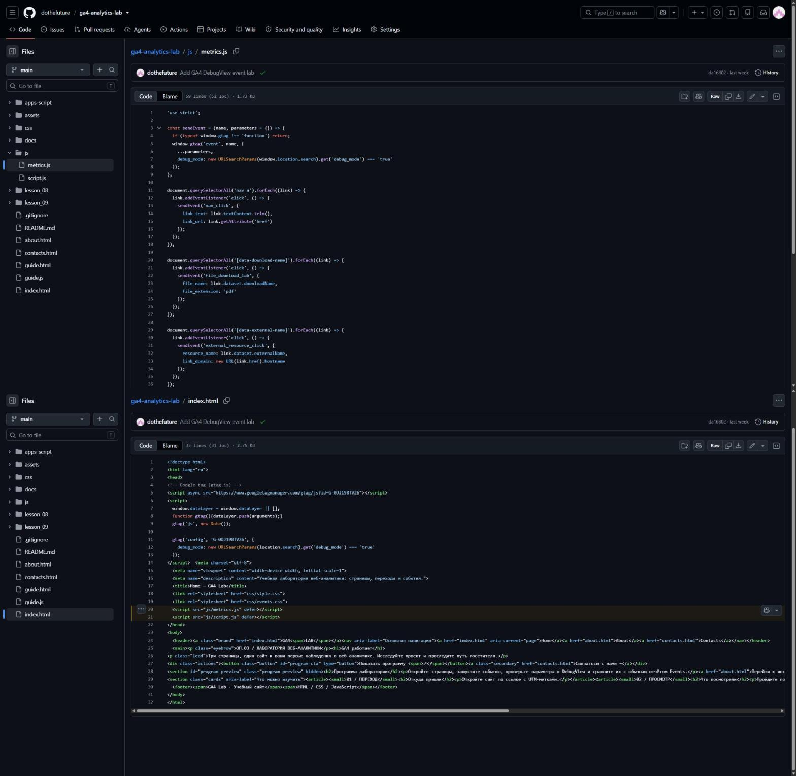
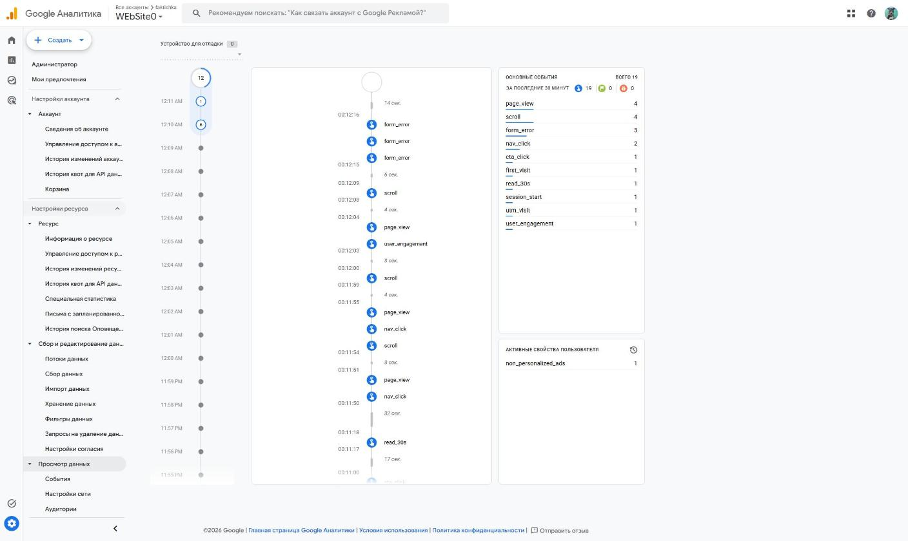
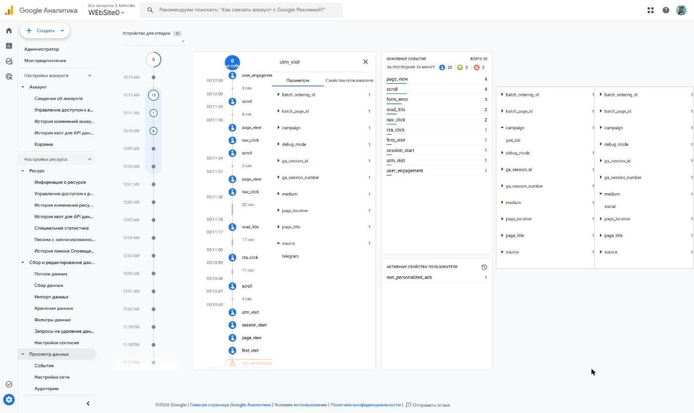
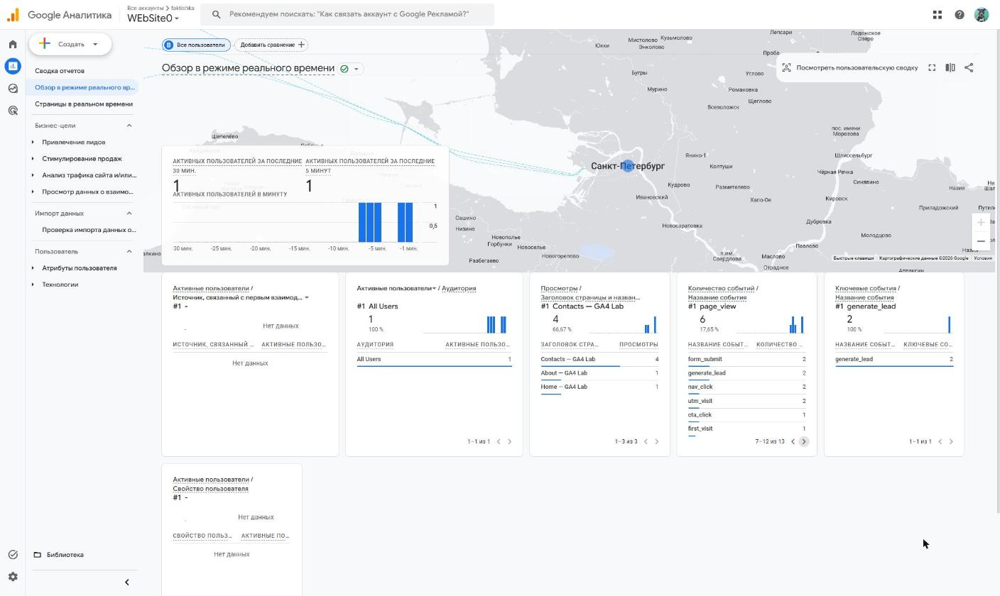

# Домашняя работа № 4 · Свои события и параметры в GA4

**Дисциплина:** ОП.03 «Информационные технологии»

| Поле | Значение |
|---|---|
| Фамилия, имя, отчество | Сдобников Андрей Андреевич |
| Группа | РПО-2 |
| Номер работы | 4 |
| Тема работы | Свои события и параметры: четыре метрики на сайте |
| Дата сдачи | 22.10.2026 |

---

## 1. Мой сайт и мой ресурс

| Поле | Значение |
|---|---|
| Публичный адрес сайта | https://ga4-analytics-lab-two.vercel.app/ |
| Measurement ID (`G-…`) | `G-0DJ198TV26` |
| Коммит с метриками (ссылка или первые 7 символов) | [`da16802`](https://github.com/dothefuture/ga4-analytics-lab/commit/da16802) — Add GA4 DebugView event lab |
| Статус публикации | READY |
| Страницы, где подключён `js/metrics.js` | `index.html`, `about.html`, `contacts.html` — один раз, рядом с `js/script.js` |

Файл подключается после основного скрипта и на каждой странице по одному
разу: два подключения дают двойные события.

## 2. Какие метрики добавлены

| Событие | Что измеряет | Что делали, чтобы оно сработало |
|---|---|---|
| `nav_click` | клики по пунктам меню | на главной нажал About, затем Contacts в меню |
| `utm_visit` | метки кампании из адреса | открыл сайт по ссылке с `utm_source=telegram&utm_medium=social&utm_campaign=ga4_lab` |
| `read_30s` | полминуты на странице | оставил главную страницу открытой больше 30 секунд |
| `form_error` | форма не прошла проверку браузера | на Contacts нажал «Отправить заявку» с пустыми полями |



## 3. События в DebugView

| Поле | Значение |
|---|---|
| Дата и время проверки | 22.10.2026, 00:10–00:12 (часовой пояс ресурса GMT+02:00) |
| Как подключали отладку | `debug_mode`: параметр `?debug_mode=true` в адресе |
| Какие из четырёх событий пришли | все четыре: `nav_click` ×2, `utm_visit` ×1, `read_30s` ×1, `form_error` ×3 |
| Какие не пришли и почему | — |



`form_error` пришло три раза за одну попытку: обработчик срабатывает
на событие `invalid` каждого незаполненного обязательного поля (имя, email,
направление).

## 4. Параметры события `utm_visit`

**Ссылка, по которой открывали сайт:**

```
https://ga4-analytics-lab-two.vercel.app/?debug_mode=true&utm_source=telegram&utm_medium=social&utm_campaign=ga4_lab
```

| Параметр | Значение в ссылке | Значение в GA4 |
|---|---|---|
| `utm_source` | `telegram` | `telegram` (параметр `source`) |
| `utm_medium` | `social` | `social` (параметр `medium`) |
| `utm_campaign` | `ga4_lab` | `ga4_lab` (параметр `campaign`) |
| `landing_page` | — | отдельно не передаётся; адрес виден в `page_location`, заголовок — `Home — GA4 Lab` |



Если значение в GA4 отличается от значения в ссылке, напишите, в чём разница
и почему так вышло.

> Значения совпадают. Отличаются только имена параметров: скрипт отправляет
> их без префикса `utm_` — `source`, `medium`, `campaign`. DebugView
> раскрывает по одному параметру за раз, поэтому кадр склеен из трёх:
> слева раскрыт `source`, справа — `campaign` и `medium`.

## 5. Событие вне отладки

| Поле | Значение |
|---|---|
| Где проверяли | Realtime (Обзор в режиме реального времени) |
| Какое событие искали | `nav_click`, `utm_visit`, `read_30s` |
| Сколько срабатываний показал экран | `nav_click` — 2, `utm_visit` — 2, `read_30s` — 2 (в карточке «Количество событий», строки 7–12) |
| Период (для отчёта) | последние 30 минут, 22.10.2026 |



## 6. Что эти метрики показывают про сайт

> Посетитель с главной сразу идёт по меню в About и Contacts, то есть
> меню используется как основной путь к форме. Полминуты на главной —
> обычное поведение при знакомстве с сайтом. Форма «спотыкается», если
> нажать отправку без данных: `form_error` показывает, сколько людей
> пытались отправить неполную заявку.

## 7. Что не получилось

> Всё сработало.

## 8. Использование ИИ

| Вопрос | Ответ |
|---|---|
| Что сделано самостоятельно | подключение `metrics.js`, публикация, проверка событий на сайте, DebugView и Realtime |
| Что спрошено у модели | помощь со снятием кадров и оформлением бланка |
| Что после этого изменено | значения в бланке сверены с кадрами DebugView и Realtime |
