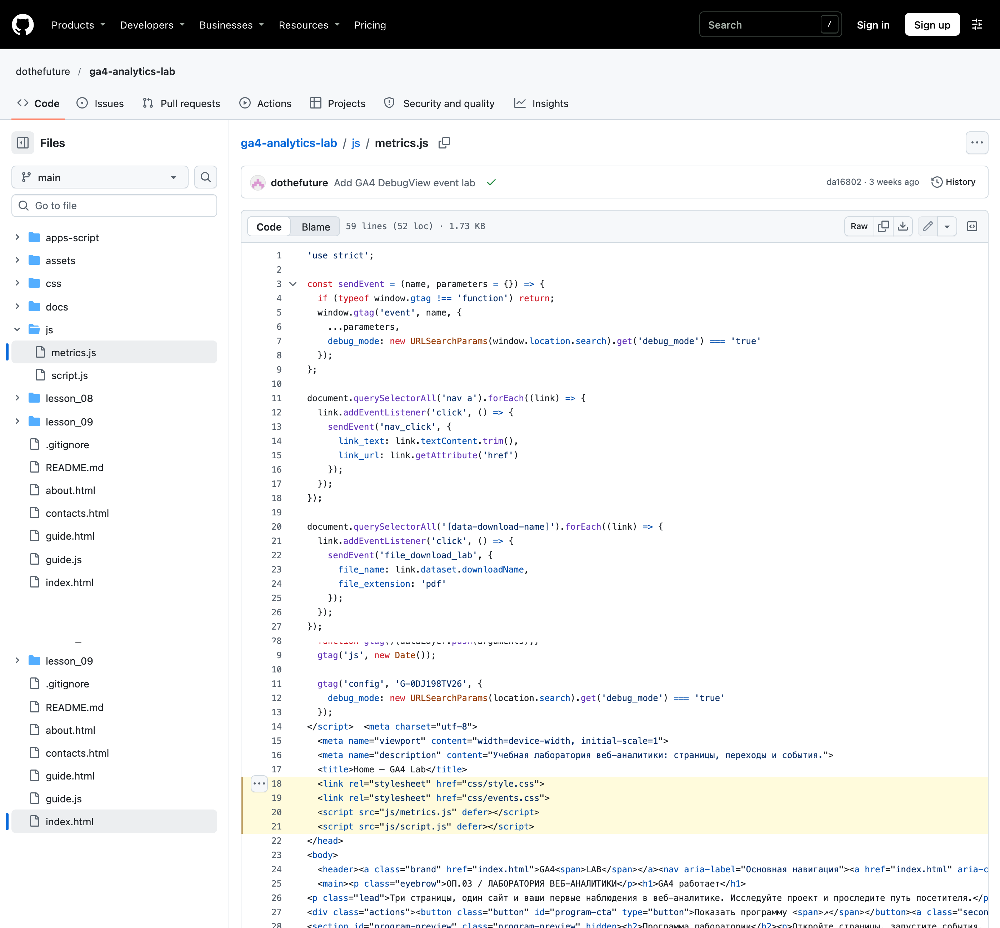
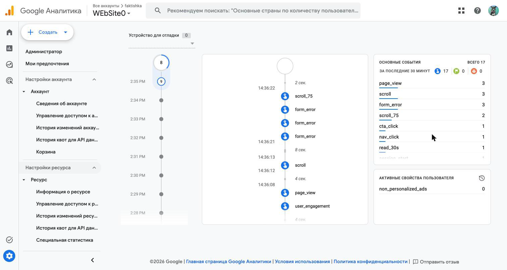
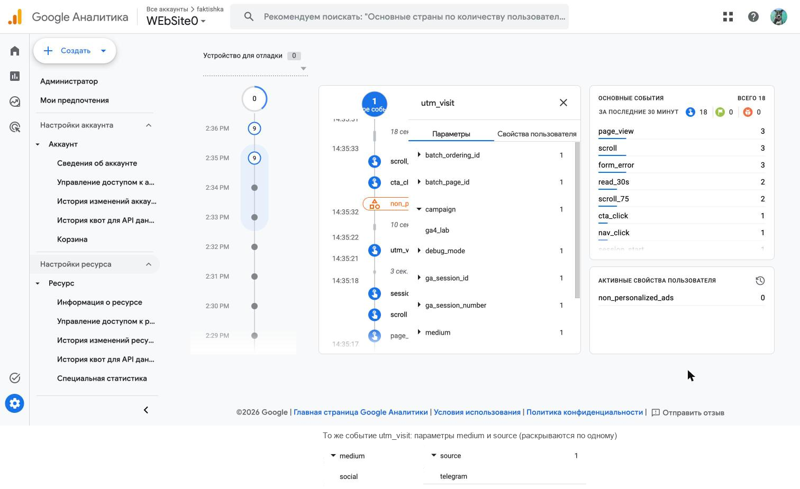
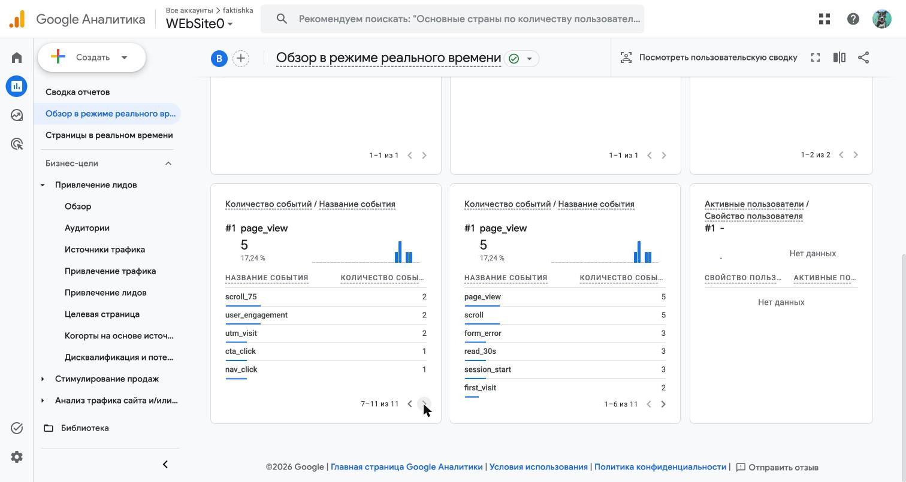

# Домашняя работа № 4 · Свои события и параметры в GA4

**Дисциплина:** ОП.03 «Информационные технологии»

| Поле | Значение |
|---|---|
| Фамилия, имя, отчество | Сдобников Андрей Андреевич |
| Группа | РПО 25/2 |
| Номер работы | 4 |
| Тема работы | Свои события и параметры: четыре метрики на сайте |
| Дата сдачи | 05.11.2026 |

---

## 1. Мой сайт и мой ресурс

| Поле | Значение |
|---|---|
| Публичный адрес сайта | https://ga4-analytics-lab-two.vercel.app |
| Measurement ID (`G-…`) | `G-0DJ198TV26` |
| Коммит с метриками (ссылка или первые 7 символов) | `da16802` — Add GA4 DebugView event lab; доработка — `f1ff3c8` |
| Статус публикации | READY |
| Страницы, где подключён `js/metrics.js` | `index.html`, `about.html`, `contacts.html` |

## 2. Какие метрики добавлены

| Событие | Что измеряет | Что делали, чтобы оно сработало |
|---|---|---|
| `nav_click` | клики по пунктам меню | нажал в шапке «About» и «Contacts» |
| `utm_visit` | метки кампании из адреса | открыл главную по ссылке с `utm_source=telegram` |
| `read_30s` | полминуты на странице | оставил вкладку открытой на 30+ секунд |
| `form_error` | форма не прошла проверку браузера | на `contacts.html` нажал «Отправить» с пустыми полями |

`form_error` отправляет `js/script.js`, потому что он висит на событии
`invalid` самой формы. Остальные три отправляет `js/metrics.js`. Кроме них
в файле есть `scroll_75`: прокрутка страницы на три четверти.

### Кадр 1 · Код метрик



> **Что на кадре.** Сверху `js/metrics.js` на GitHub: функция `sendEvent`
> добавляет к каждому событию `debug_mode`, ниже обработчик `nav_click`.
> Снизу `index.html`: в строке 20 подключён `js/metrics.js` с `defer`,
> в строке 21 — основной `js/script.js`. Каждый файл подключён один раз.

## 3. События в DebugView

| Поле | Значение |
|---|---|
| Дата и время проверки | 05.11.2026, 14:35–14:36 |
| Как подключали отладку | `debug_mode`: открывал сайт с `?debug_mode=true` |
| Какие из четырёх событий пришли | все четыре: `nav_click`, `utm_visit`, `read_30s`, `form_error` |
| Какие не пришли и почему | все пришли |

### Кадр 2 · Лента DebugView



> **Что на кадре.** В центре лента одного сеанса по секундам:
> `page_view` → `scroll` → три `form_error` подряд (три пустых поля) →
> `scroll_75`. Справа счётчик за 30 минут: всего 17 событий, среди них
> `form_error` 3, `cta_click` 1, `nav_click` 1, `read_30s` 1.

## 4. Параметры события `utm_visit`

**Ссылка, по которой открывали сайт:**

```
https://ga4-analytics-lab-two.vercel.app/?utm_source=telegram&utm_medium=social&utm_campaign=ga4_lab&debug_mode=true
```

| Параметр | Значение в ссылке | Значение в GA4 |
|---|---|---|
| `utm_source` | `telegram` | `source` = `telegram` |
| `utm_medium` | `social` | `medium` = `social` |
| `utm_campaign` | `ga4_lab` | `campaign` = `ga4_lab` |
| `landing_page` | — | в моём `metrics.js` не передаётся; страница входа видна в `page_location` события `page_view` |

### Кадр 3 · Параметры utm_visit



> **Что на кадре.** В DebugView открыто событие `utm_visit`, вкладка
> «Параметры». Раскрыт `campaign` = `ga4_lab`, ниже `debug_mode`,
> `ga_session_id`. Под кадром отдельно раскрыты `medium` = `social`
> и `source` = `telegram`: в окне DebugView параметр раскрывается только
> по одному.

**Почему названия параметров отличаются от ссылки:**

> Значения совпали полностью. Отличаются только имена: скрипт отправляет
> `campaign_source`, `campaign_medium`, `campaign_name`, а GA4 узнаёт эти
> служебные имена и показывает их как `source`, `medium`, `campaign`.

## 5. Событие вне отладки

| Поле | Значение |
|---|---|
| Где проверяли | Realtime |
| Какое событие искали | `utm_visit` и `nav_click` |
| Сколько срабатываний показал экран | `utm_visit` 2, `nav_click` 1, `read_30s` 3, `form_error` 3 |
| Период (для отчёта) | последние 30 минут, 05.11.2026 |

### Кадр 4 · Realtime



> **Что на кадре.** Две карточки «Количество событий» в Realtime. Слева
> вторая страница списка: `scroll_75` 2, `user_engagement` 2, `utm_visit` 2,
> `cta_click` 1, `nav_click` 1. Справа первая: `page_view` 5, `scroll` 5,
> `form_error` 3, `read_30s` 3. Всего 11 разных событий.

## 6. Что эти метрики показывают про сайт

> Форма спотыкается: `form_error` пришёл трижды за одну попытку, браузер
> ругается на каждое пустое обязательное поле отдельно. `read_30s`
> срабатывает чаще, чем `scroll_75`: люди задерживаются на главной, но не
> всегда листают до конца. По меню ходят редко, всего один `nav_click`:
> в основном переходят по кнопкам на странице.

## 7. Что не получилось

> Всё получилось.

## 8. Использование ИИ

| Вопрос | Ответ |
|---|---|
| Что сделано самостоятельно | подключил `metrics.js` на три страницы, вызвал каждое событие на сайте, проверил DebugView и Realtime, снял кадры |
| Что спрошено у модели | почему `campaign_source` в DebugView называется `source` |
| Что после этого изменено | дописал объяснение в раздел 4 и сверил значения по кадру |
