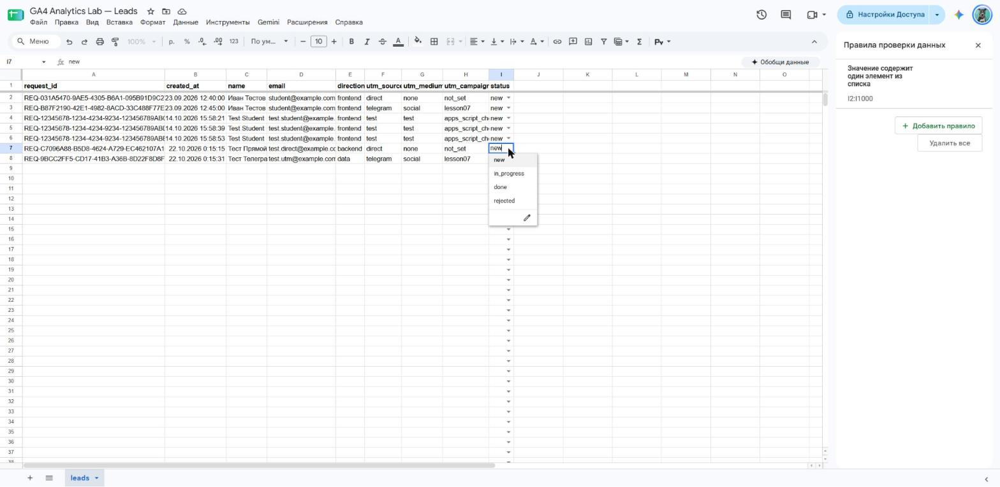
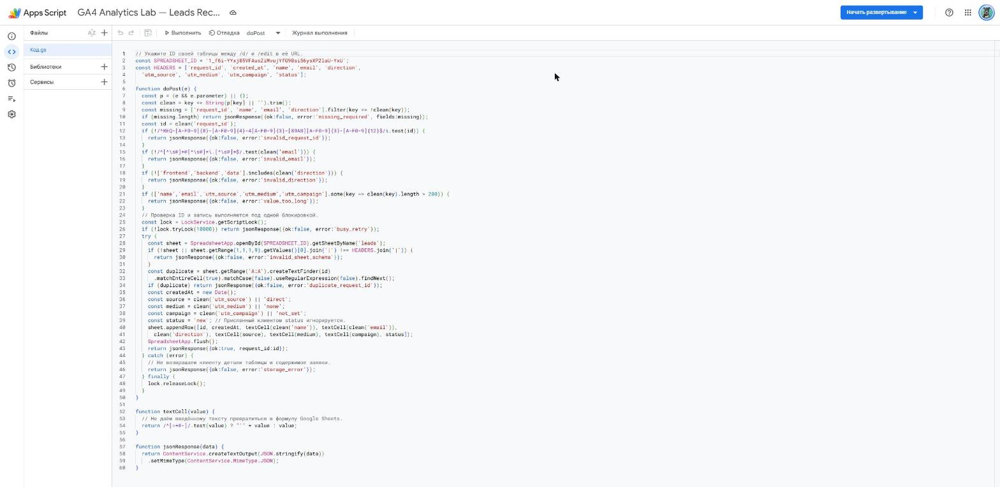
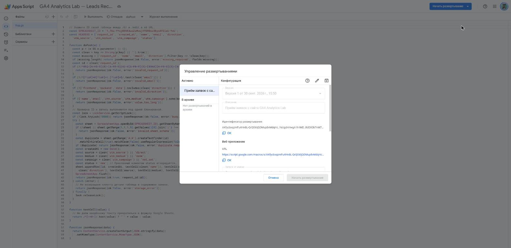
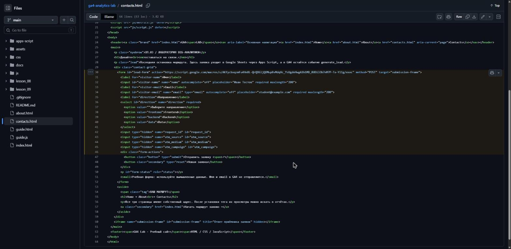
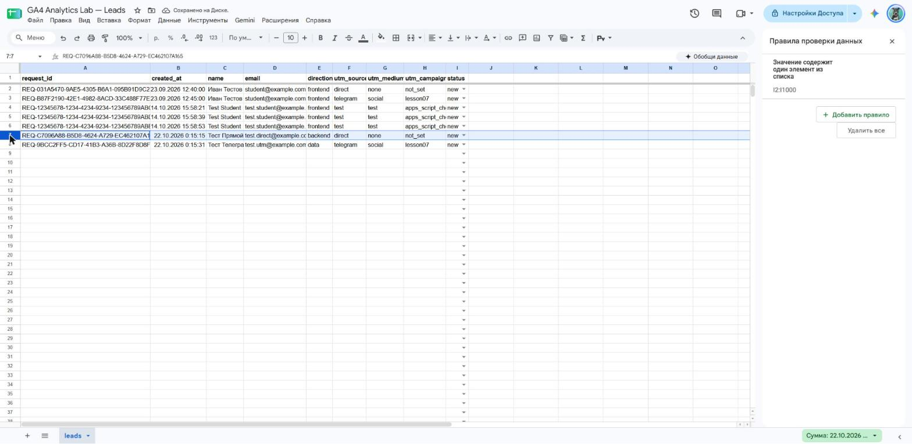
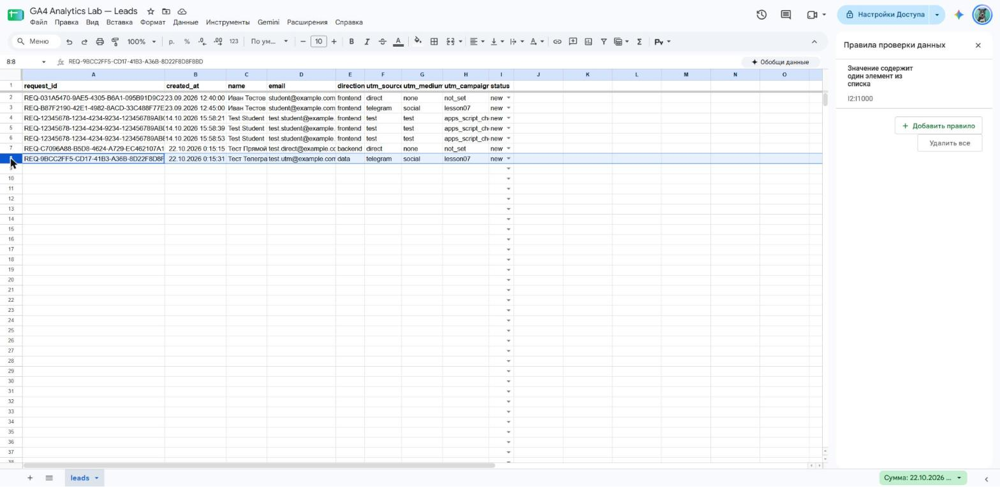
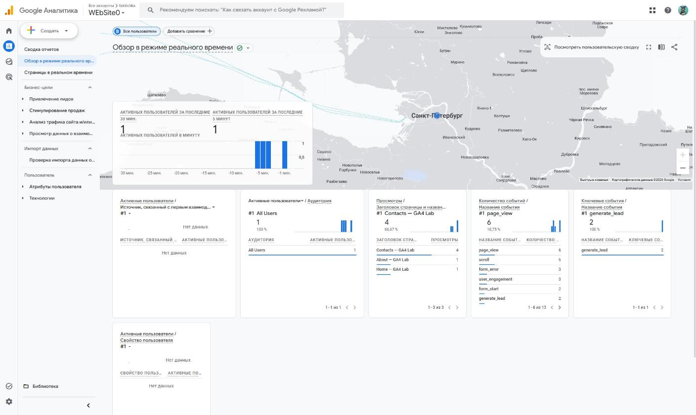
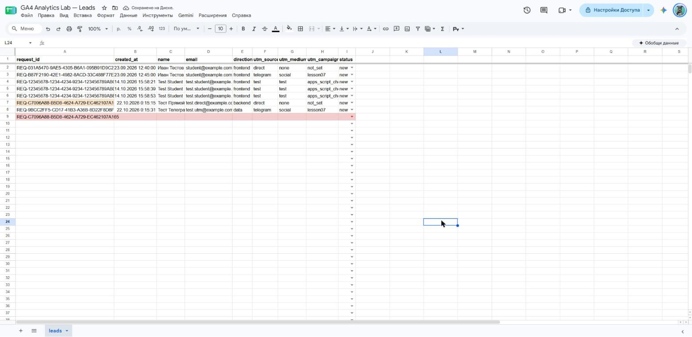
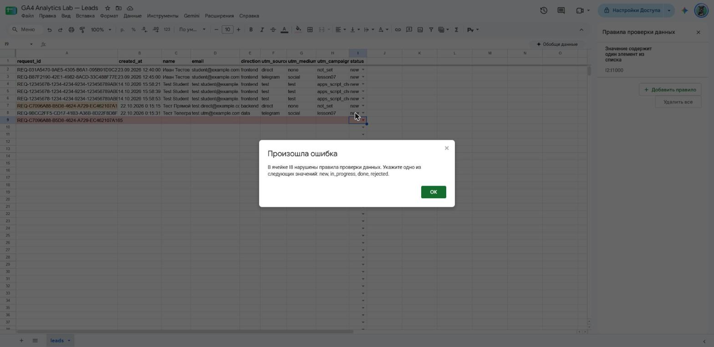

# Домашняя работа № 5 · Контролируемая таблица заявок

**Дисциплина:** ОП.03 «Информационные технологии»

| Поле | Значение |
|---|---|
| Фамилия, имя, отчество | Сдобников Андрей Андреевич |
| Группа | РПО-2 |
| Номер работы | 5 |
| Тема работы | Форма сайта → Apps Script → Google Таблица заявок |
| Дата сдачи | 22.10.2026 |

---

## 1. Таблица

Я создал таблицу «GA4 Analytics Lab — Leads» с листом `leads`. В первой
строке девять заголовков: `request_id`, `created_at`, `name`, `email`,
`direction`, `utm_source`, `utm_medium`, `utm_campaign`, `status`. Строка
заголовков закреплена, у статуса список из четырёх значений: `new`,
`in_progress`, `done`, `rejected`. Два правила подсвечивают неполную строку
и повторный `request_id`.

Ссылка на таблицу (доступ открыт только преподавателю): https://docs.google.com/spreadsheets/d/1_f6i-YYxj85VFAusZiMvujYfG9Bsi56ysXP2laU-YxU/edit

## 2. Приёмник и форма

Я вставил `Code.gs` из материалов в Apps Script, указал ID своей таблицы
и опубликовал проект как Web app. Форму в `contacts.html` заменил
фрагментом из материалов, в `action` поставил адрес своего Web app,
обработчик формы в `js/script.js` заменил новым.

| Мои данные | Значение |
|---|---|
| Публичный адрес сайта | https://ga4-analytics-lab-two.vercel.app/ |
| Measurement ID (`G-…`) | `G-0DJ198TV26` |
| Коммит с новой формой (первые 7 символов) | [`ebf27ca`](https://github.com/dothefuture/ga4-analytics-lab/commit/ebf27ca) — Connect contact form to Apps Script |

Развёртывание Apps Script: «Приём заявок с сайта GA4 Analytics Lab»,
версия 1 от 30.09.2026, тип Web app. Для кадра 4 разметка формы разбита
на строки коммитом [`6abfcb9`](https://github.com/dothefuture/ga4-analytics-lab/commit/6abfcb9),
поведение формы не менялось.

## 3. Две тестовые заявки

Первую заявку я отправил со страницы без меток: в таблице записалось
`direct` / `none` / `not_set` и статус `new`. Вторую отправил по ссылке
с метками `telegram` / `social` / `lesson07`, и они записались в свои
столбцы.

| | Заявка без меток | Заявка с метками |
|---|---|---|
| `request_id` | `REQ-C7096A88-B5D8-4624-A729-EC462107A165` | `REQ-9BCC2FF5-CD17-41B3-A36B-8D22F8D8F8BD` |

Ссылка для второй заявки:
`https://ga4-analytics-lab-two.vercel.app/contacts.html?utm_source=telegram&utm_medium=social&utm_campaign=lesson07`

## 4. Событие в аналитике

После отправки в GA4 пришло событие `generate_lead`. Оно показывает
попытку отправки формы, а сама заявка подтверждается строкой в таблице.
В Realtime: `generate_lead` — 2, в карточке ключевых событий тоже 2.

## 5. Проверки

Форма с пустыми полями не отправилась: браузер остановил отправку,
а в GA4 пришло `form_error`. Копия строки с тем же `request_id`
подсветилась, после кадра я её удалил. Статус `closed` таблица
не приняла, а через список статус тестовой заявки сменился
`new` → `in_progress` → `done`.

---

Не получилось (если всё работает, оставьте пустым):

ИИ: использовал для помощи со снятием кадров и оформлением бланка; данные
в бланке сверены с таблицей и GA4.
