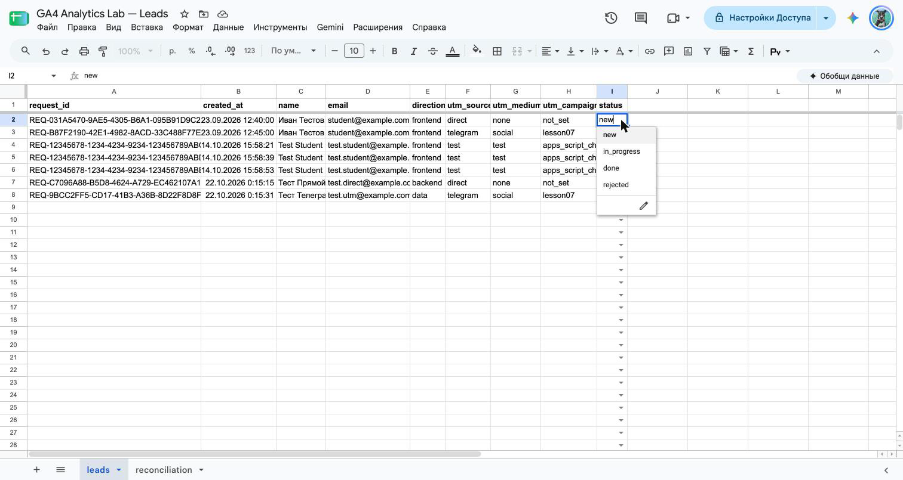
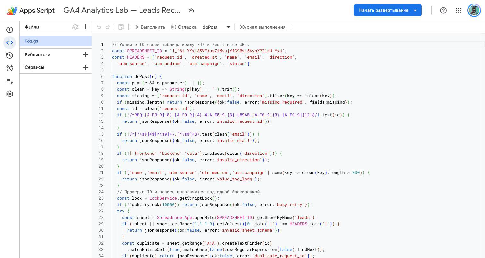
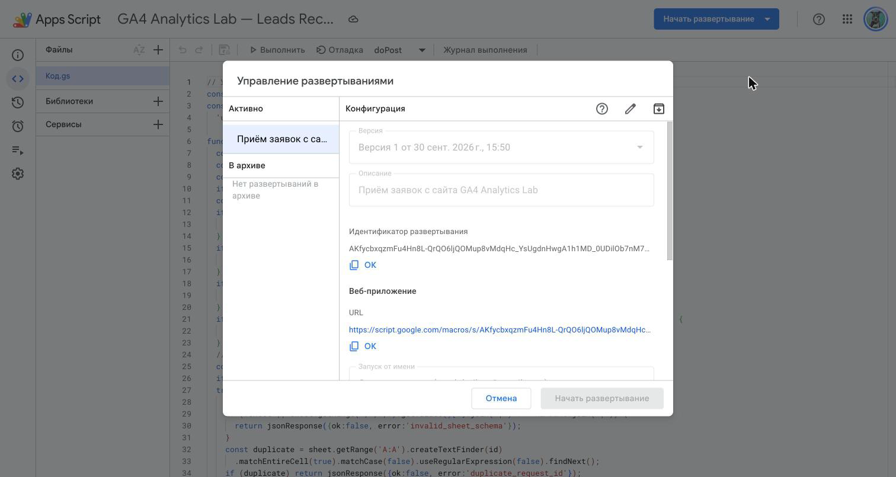
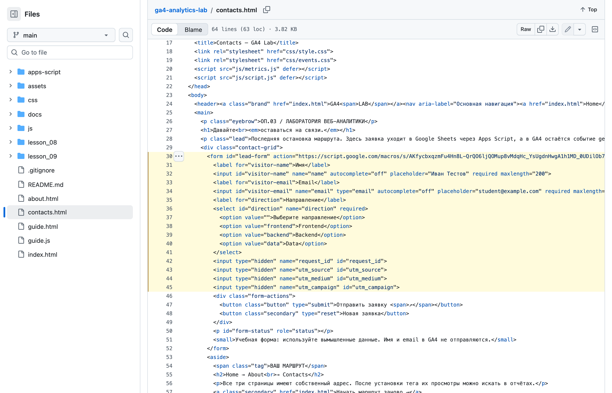
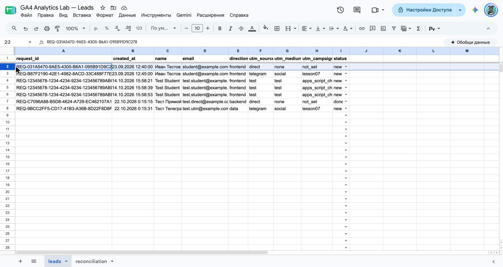
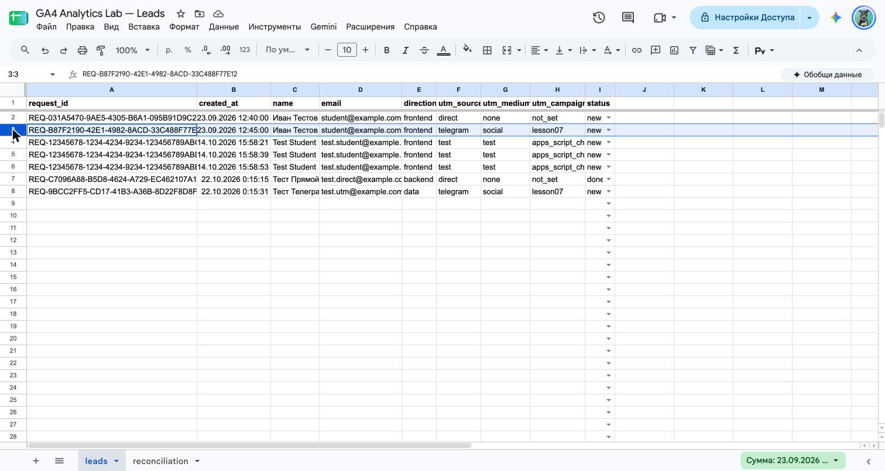
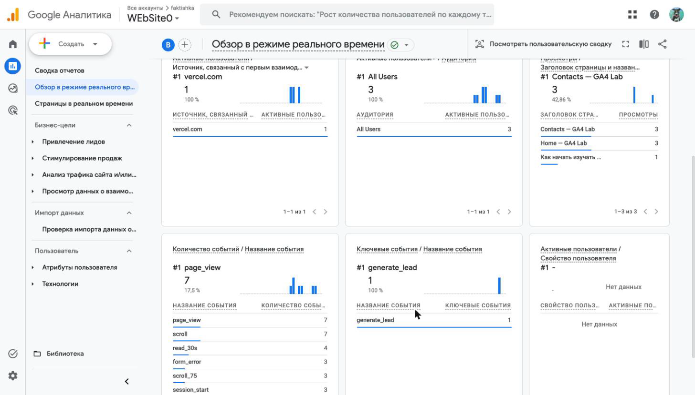
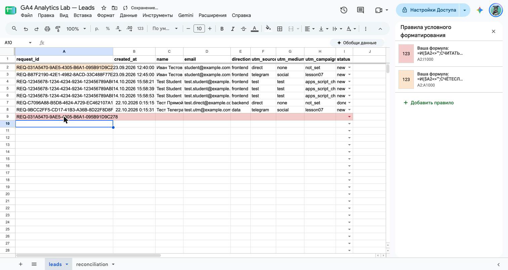
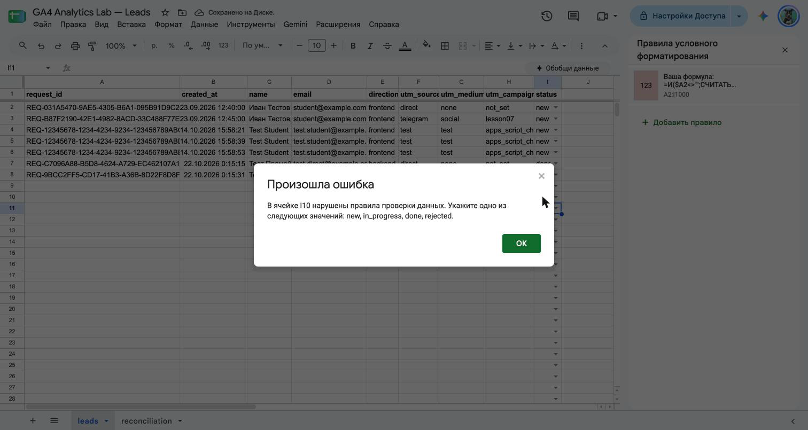

# Домашняя работа № 5 · Контролируемая таблица заявок

**Дисциплина:** ОП.03 «Информационные технологии»

| Поле | Значение |
|---|---|
| Фамилия, имя, отчество | Сдобников Андрей Андреевич |
| Группа | РПО 25/2 |
| Номер работы | 5 |
| Тема работы | Форма сайта → Apps Script → Google Таблица заявок |
| Дата сдачи | 05.11.2026 |

---

## 1. Таблица

Я создал таблицу «GA4 Analytics Lab — Leads» с листом `leads`. В первой
строке девять заголовков: `request_id`, `created_at`, `name`, `email`,
`direction`, `utm_source`, `utm_medium`, `utm_campaign`, `status`. Строка
заголовков закреплена, у статуса список из четырёх значений: `new`,
`in_progress`, `done`, `rejected`. Два правила подсвечивают неполную строку
и повторный `request_id`.

Ссылка на таблицу (доступ открыт только преподавателю):
https://docs.google.com/spreadsheets/d/1_f6i-YYxj85VFAusZiMvujYfG9Bsi56ysXP2laU-YxU/edit

### Кадр 1 · Лист leads

> **Что на кадре.** Лист `leads`, под первой строкой серая линия закрепления.
> В ячейке `I2` раскрыт список статусов: `new`, `in_progress`, `done`,
> `rejected`. Другие значения таблица не примет. Внизу два листа: `leads`
> и `reconciliation` (сверка из задания 9).

## 2. Приёмник и форма

Я вставил `Code.gs` из материалов в Apps Script, указал ID своей таблицы
и опубликовал проект как Web app. Форму в `contacts.html` заменил
фрагментом из материалов, в `action` поставил адрес своего Web app,
обработчик формы в `js/script.js` заменил новым.

| Мои данные | Значение |
|---|---|
| Публичный адрес сайта | https://ga4-analytics-lab-two.vercel.app |
| Measurement ID (`G-…`) | `G-0DJ198TV26` |
| Коммит с новой формой (первые 7 символов) | `ebf27ca` — Connect contact form to Apps Script |

### Кадр 2 · Code.gs

> **Что на кадре.** Проект Apps Script «GA4 Analytics Lab — Leads Receiver».
> Строка 2: `SPREADSHEET_ID` — ID моей таблицы из её адреса. Ниже `doPost`
> проверяет заявку до записи: обязательные поля, формат `request_id`
> и email, допустимые направления, длину значений. Строки 32–34 отклоняют
> повторный `request_id`.

### Кадр 3 · Развёртывание

> **Что на кадре.** «Управление развертываниями»: активное развёртывание
> «Приём заявок с сайта GA4 Analytics Lab», версия 1 от 30 сентября.
> Ниже URL веб-приложения `https://script.google.com/macros/s/AKfycbxqzm…/exec` —
> этот адрес стоит в `action` формы.

### Кадр 4 · Форма в contacts.html

> **Что на кадре.** `contacts.html` на GitHub: у `<form>` метод `POST`
> и `action` с адресом `/exec`. Скрытые поля `request_id`, `utm_source`,
> `utm_medium`, `utm_campaign` заполняет `js/script.js`: метки берёт из
> адреса страницы, а если их нет, подставляет `direct` / `none` / `not_set`.

## 3. Две тестовые заявки

Первую заявку я отправил со страницы без меток: в таблице записалось
`direct` / `none` / `not_set` и статус `new`. Вторую отправил по ссылке
с метками `telegram` / `social` / `lesson07`, и они записались в свои
столбцы.

| | Заявка без меток | Заявка с метками |
|---|---|---|
| `request_id` | `REQ-031A5470-9AE5-4305-B6A1-095B91D9C278` | `REQ-B87F2190-42E1-4982-8ACD-33C488F77E12` |

### Кадр 5 · Заявка без меток

> **Что на кадре.** Выделена строка 2: `direct` / `none` / `not_set`,
> статус `new`. Полный `request_id` виден в строке формул сверху.

### Кадр 6 · Заявка с метками

> **Что на кадре.** Выделена строка 3: та же форма, но открытая по ссылке
> с метками. Записалось `telegram` / `social` / `lesson07`. Строки 4–6 —
> проверочные заявки самого скрипта (`test` / `apps_script_check`), строки
> 7–8 — повторная проверка 22 октября.

## 4. Событие в аналитике

После отправки в GA4 пришло событие `generate_lead`. Оно показывает
попытку отправки формы, а сама заявка подтверждается строкой в таблице.

### Кадр 7 · generate_lead

> **Что на кадре.** Realtime: в карточке «Ключевые события» —
> `generate_lead` 1. Я отметил его ключевым, поэтому GA4 вынес его отдельно.
> Справа просмотры страниц: `Contacts — GA4 Lab` 3, с неё и ушла форма.

## 5. Проверки

Форма с пустым именем не отправилась. Повторная отправка без кнопки
«Новая заявка» не добавила строку. Копия строки с тем же `request_id`
подсветилась, после кадра я её удалил. Статус `finished` таблица
не приняла, а через список статус сменился `new` → `in_progress` → `done`.

### Кадр 8 · Дубль

> **Что на кадре.** В строку 9 вставлен тот же `request_id`, что в строке 2.
> Обе ячейки подсвечены оранжевым правилом `СЧЁТЕСЛИ`, а неполная строка 9 —
> ещё и красным. Справа открыты оба правила условного форматирования.

### Кадр 9 · Неверный статус

> **Что на кадре.** В `I10` ввёл `finished`. Таблица показала «Произошла
> ошибка… Укажите одно из следующих значений: new, in_progress, done,
> rejected» и не сохранила значение. У строки 7 статус уже `done`: его
> я менял через список.

---

Не получилось (если всё работает, оставьте пустым):

ИИ: использовал, чтобы разобраться, как Apps Script отвечает на дубль `request_id`, и для формулировок подписей к кадрам.
