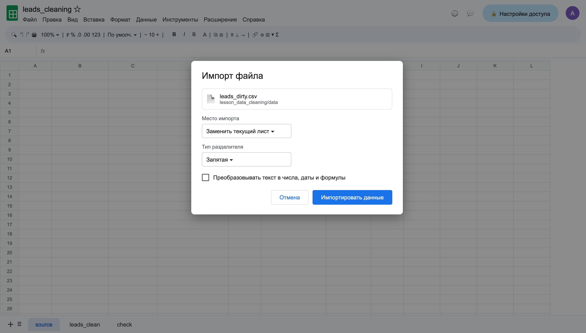
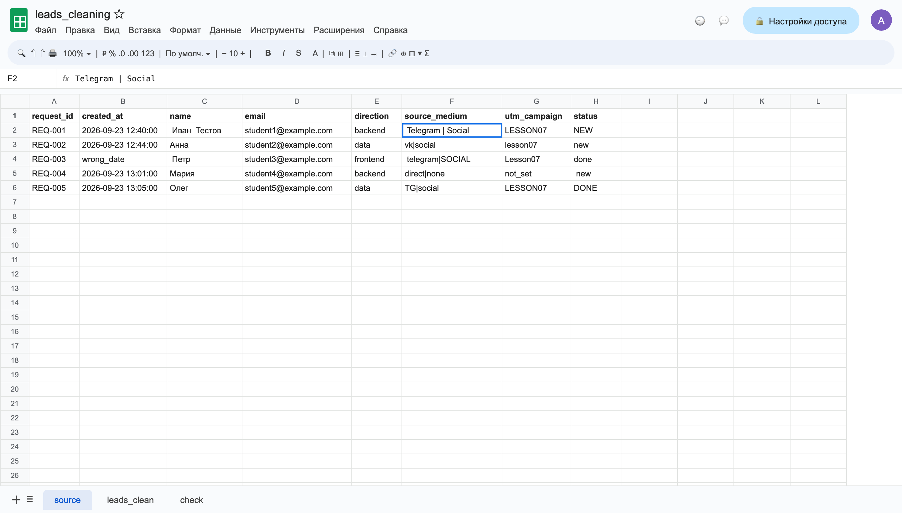
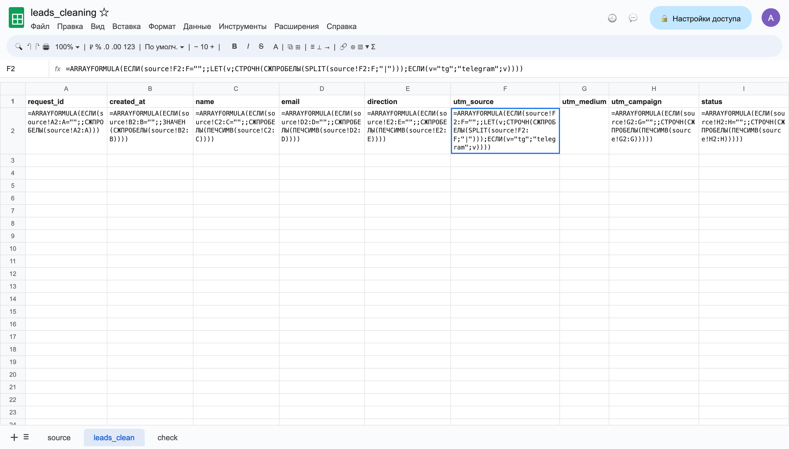
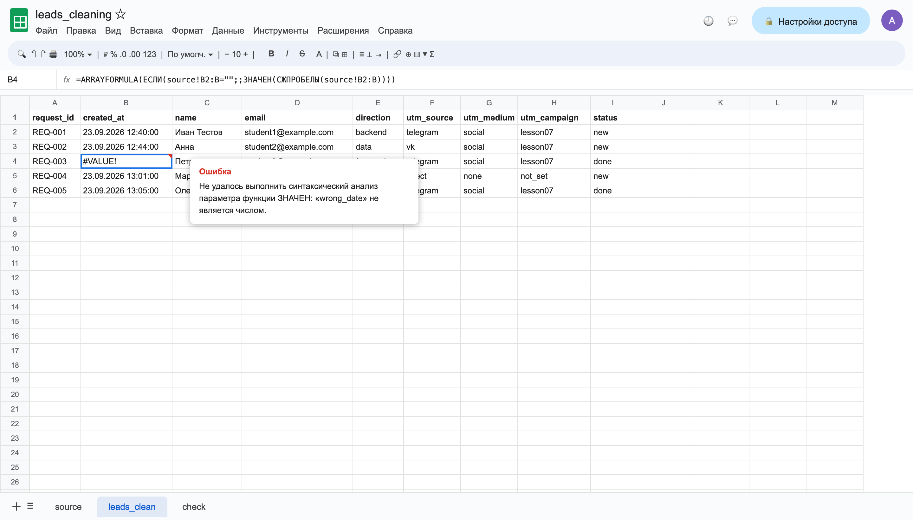
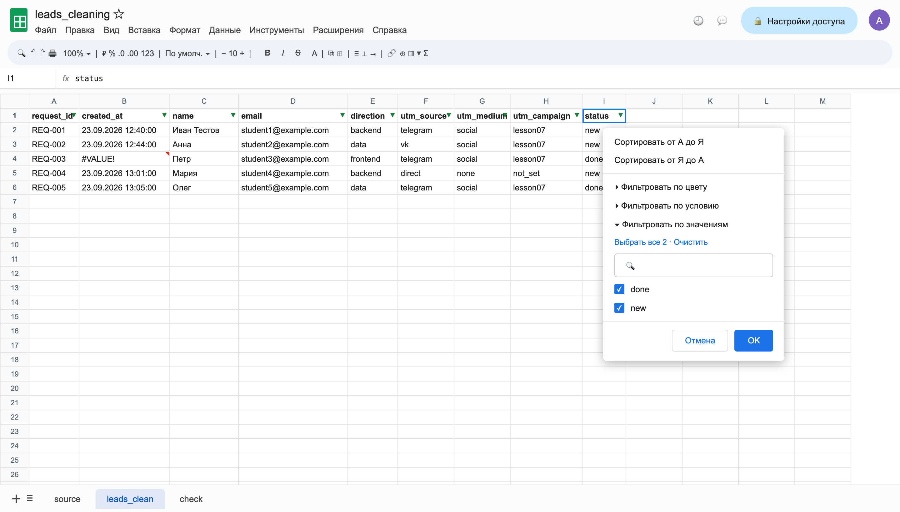
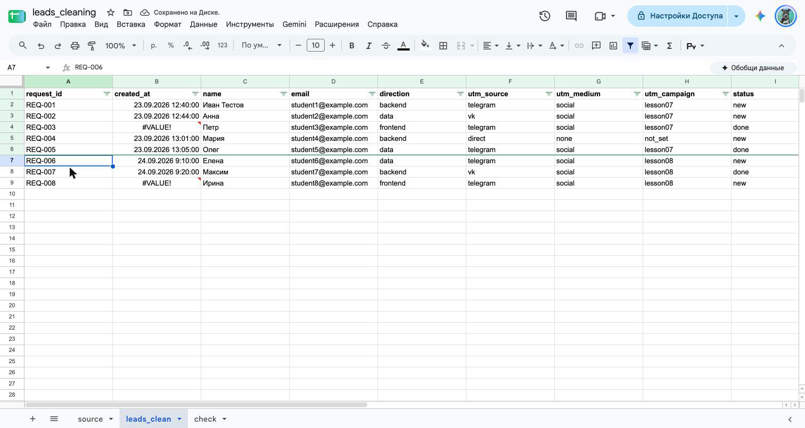
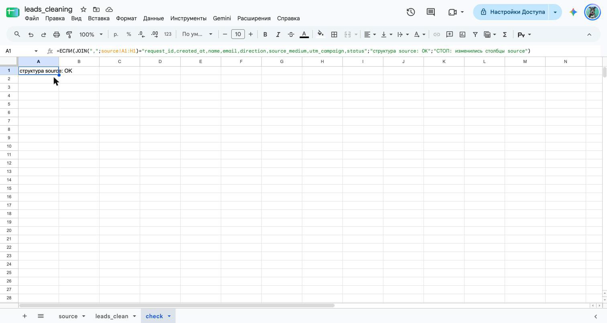

# Домашняя работа № 6 · Подготовка данных в Google Таблицах

**Дисциплина:** ОП.03 «Информационные технологии»

| Поле | Значение |
|---|---|
| Фамилия, имя, отчество | Сдобников Андрей Андреевич |
| Группа | РПО 25/2 |
| Номер работы | 6 |
| Тема работы | Повторяемая очистка выгрузки заявок в Google Таблицах |
| Дата сдачи | 05.11.2026 |

---

## 1. Импорт

Я создал таблицу `leads_cleaning` и импортировал `leads_dirty.csv` на лист
`source` с целью «Заменить текущий лист» и снятым флажком «Преобразовывать
текст в числа, даты и формулы». Данные на `source` остались такими,
как в файле, и я их не редактировал.

Ссылка на таблицу (доступ открыт только преподавателю):
https://docs.google.com/spreadsheets/d/1EnwPQ9GOQKvoqOXRHCIFTqN-1KeV_1yUHl19U9D_wIc/edit

### Кадр 1 · Импорт

> **Что на кадре.** Окно «Импорт файла» перед нажатием кнопки: файл
> `leads_dirty.csv`, место — «Заменить текущий лист», разделитель — запятая.
> Флажок «Преобразовывать текст в числа, даты и формулы» снят, иначе
> Таблицы сами поменяли бы даты и регистр ещё на `source`.

### Кадр 2 · Лист source

> **Что на кадре.** Лист `source` после импорта: всё как в файле. Видно,
> что надо чистить: пробелы вокруг имён, `Telegram | Social` и `TG|social`
> в одном столбце, `LESSON07` / `Lesson07`, `NEW` / ` new `, дата
> `wrong_date` у `REQ-003`.

## 2. Правила

На листе `leads_clean` девять заголовков, и в каждом столбце одна формула
ARRAYFORMULA во второй строке. Формулы убирают лишние пробелы, делят
`source_medium` на источник и канал, приводят метки и статус к нижнему
регистру и заменяют `tg` на `telegram`.

### Кадр 3 · Формулы

> **Что на кадре.** Включено «Вид → Показать → Формулы». Во второй строке
> восемь формул, ниже ручных значений нет. `G2` пустая: столбец заполняет
> `SPLIT` из `F2` (выделена) — он делит `source_medium` по `|` на два
> столбца сразу. `LET` заменяет `tg` на `telegram`.

## 3. Ошибка и проверка значений

В строке `REQ-003` дата записана как `wrong_date`, поэтому в `created_at`
стоит `#VALUE!`. Я оставил ошибку видимой, чтобы не потерять неверную
запись. В фильтре `status` после очистки только `done` и `new`.

### Кадр 4 · #VALUE!

> **Что на кадре.** Выделена `B4`, в углу красный треугольник. Подсказка:
> `ЗНАЧЕН` не смог превратить `wrong_date` в дату. `ЕСЛИОШИБКА` я не ставил:
> пустая ячейка спрятала бы плохую строку, а так её сразу видно.

### Кадр 5 · Фильтр status

> **Что на кадре.** На `leads_clean` включён фильтр, раскрыт столбец
> `status`. В списке значений только два: `done` и `new`. Исходные `NEW`,
> ` new `, `DONE` слились в два значения.

## 4. Вторая выгрузка

Я импортировал `leads_dirty_v2.csv` на тот же лист `source`. Формулы
не менял: в `leads_clean` стало 8 строк вместо 5, ошибочные даты видны
у `REQ-003` и `REQ-008`. Строка `REQ-006` очистилась в
Елена / telegram / social / lesson08 / new. Результат скачан и лежит
в этой папке как [`leads_clean.csv`](leads_clean.csv).

### Кадр 6 · После v2

> **Что на кадре.** `leads_clean` после второго импорта: 8 строк.
> Выделена строка `REQ-006`: из ` Елена `, ` TG | SOCIAL `, ` LESSON08 `,
> ` NEW ` получилось `Елена` / `telegram` / `social` / `lesson08` / `new`.
> `REQ-007` — `Максим` / `vk` / `social` / `lesson08` / `done`.
> `#VALUE!` у `REQ-003` и `REQ-008`.

## 5. Проверка структуры

На листе `check` формула сравнивает заголовки `source` с ожидаемыми
и показывает «структура source: OK». Если столбцы в CSV переставят,
она покажет «СТОП: изменились столбцы source».

### Кадр 7 · Лист check

> **Что на кадре.** Лист `check`, ячейка `A1`: «структура source: OK».
> В строке формул видно, как это работает: `JOIN` склеивает заголовки
> `source!A1:H1` через запятую и сравнивает с эталонной строкой. Проверка
> стоит на отдельном листе, чтобы не попасть в скачанный CSV.

---

Не получилось (если всё работает, оставьте пустым):

ИИ: использовал, чтобы понять, почему `SPLIT` занимает два столбца, и для формулировок подписей к кадрам.
