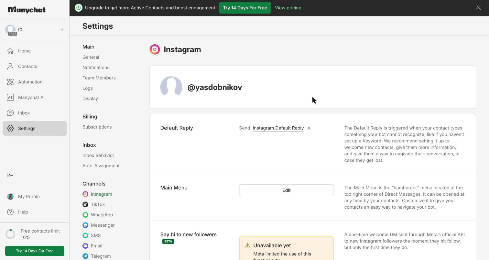
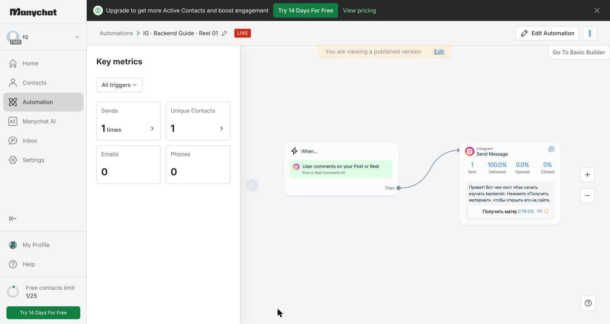
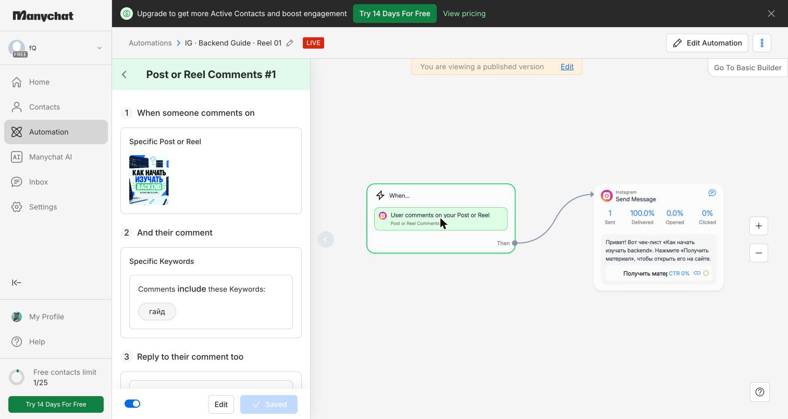
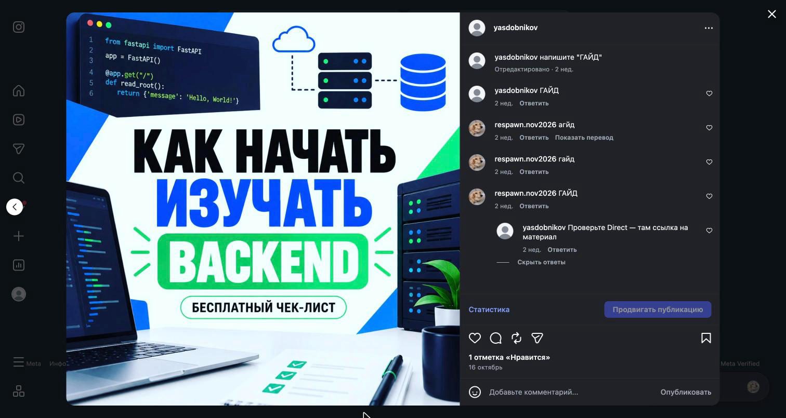
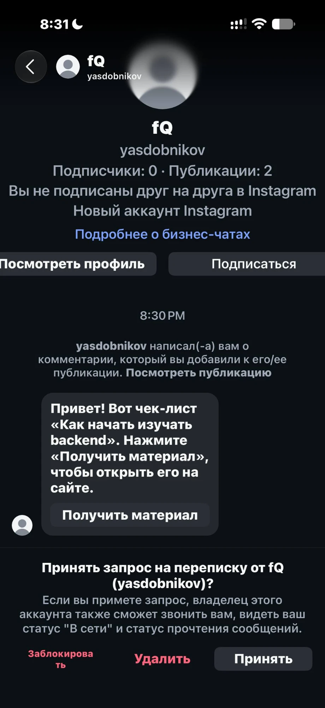
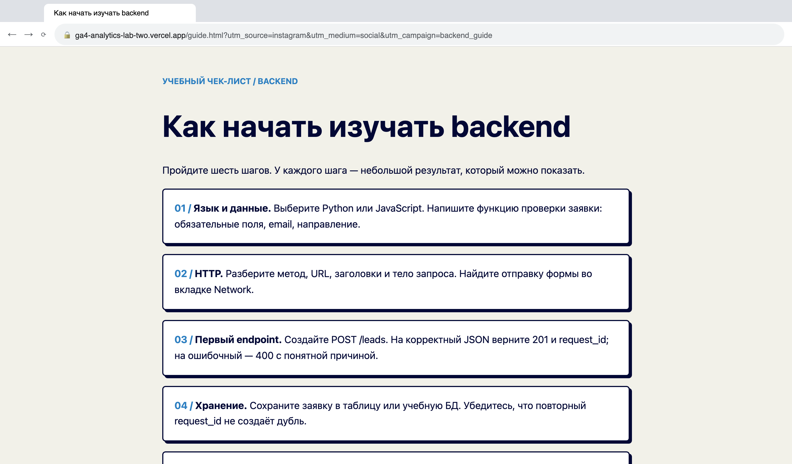
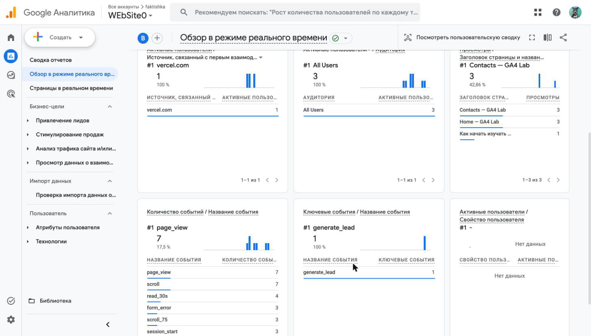
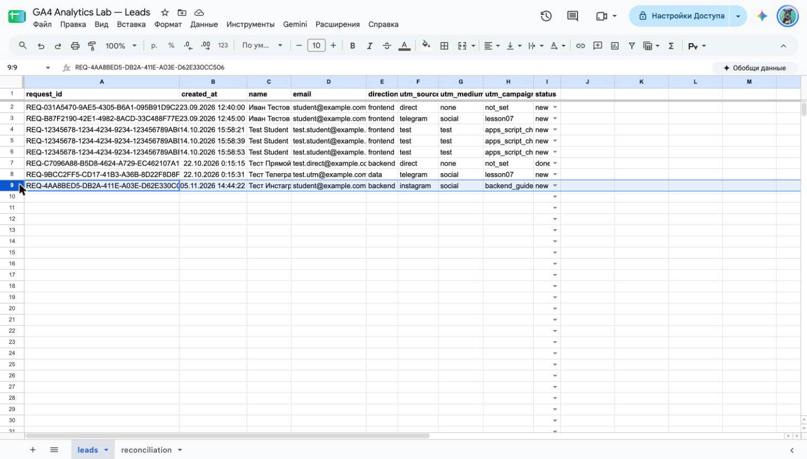

# Домашняя работа № 7 · Instagram → ManyChat → заявка

**Дисциплина:** ОП.03 «Информационные технологии»

| Поле | Значение |
|---|---|
| Фамилия, имя, отчество | Сдобников Андрей Андреевич |
| Группа | РПО 25/2 |
| Номер работы | 7 |
| Тема работы | Автоворонка из Instagram: комментарий → сообщение → сайт → заявка |
| Дата сдачи | 05.11.2026 |

---

## 1. Подключение и automation

Я перевёл учебный аккаунт Instagram в профессиональный и подключил его
к ManyChat на тарифе Free. Собрал automation: триггер на комментарий под
выбранной публикацией, ключевое слово `ГАЙД`, публичный ответ, личное
сообщение и кнопка «Получить материал» со ссылкой с UTM. Automation
включена в режиме Live.

| Мои данные | Значение |
|---|---|
| Учебный аккаунт Instagram | `@yasdobnikov` |
| Ссылка на учебную публикацию | https://www.instagram.com/p/DejByuVCABb/ |
| Публичный адрес сайта | https://ga4-analytics-lab-two.vercel.app |
| Страница из кнопки | `/guide.html?utm_source=instagram&utm_medium=social&utm_campaign=backend_guide` |
| Measurement ID (`G-…`) | `G-0DJ198TV26` |

### Кадр 1 · Instagram подключён

> **Что на кадре.** ManyChat → Settings → Channels → Instagram: подключён
> аккаунт `@yasdobnikov`. Слева значок тарифа FREE, внизу лимит контактов
> 1/25 — один контакт появился после теста.

### Кадр 2 · Flow Builder

> **Что на кадре.** Automation «IG · Backend Guide · Reel 01» со статусом
> LIVE. Слева триггер «User comments on your Post or Reel», справа
> сообщение в Direct: «Привет! Вот чек-лист „Как начать изучать backend“…»
> и кнопка «Получить материал». Счётчики: 1 отправлено, 100 % доставлено.

### Кадр 3 · Триггер

> **Что на кадре.** Настройки триггера: «Specific Post or Reel» — выбрана
> обложка «Как начать изучать backend», ключевое слово `гайд`. ManyChat
> не различает регистр, поэтому сработают и `ГАЙД`, и `гайд`. Пункт 3
> включает публичный ответ под комментарием.

## 2. Тест цепочки

Со второго аккаунта `respawn.nov2026` я оставил комментарий `ГАЙД`. Под ним появился
автоматический ответ, а в Direct пришло сообщение с кнопкой. Кнопка
открыла `guide.html` с метками в адресе, оттуда я перешёл к форме
и отправил тестовую заявку.

### Кадр 4 · Комментарий и ответ

> **Что на кадре.** Публикация «Как начать изучать BACKEND — бесплатный
> чек-лист». Под ней комментарии `respawn.nov2026`: «агйд» (опечатка — бот
> правильно промолчал), «гайд», «ГАЙД». На последний пришёл автоответ от
> `yasdobnikov`: «Проверьте Direct — там ссылка на материал».

### Кадр 5 · Сообщение в Direct

> **Что на кадре.** Телефон тестового аккаунта `faktishkaq`. Он оставил
> под той же публикацией комментарий `ГАЙД` и получил ответ «Материал уже
> в сообщениях». В Direct пришёл запрос на переписку от `yasdobnikov`:
> «Привет! Вот чек-лист „Как начать изучать backend“. Нажмите „Получить
> материал“, чтобы открыть его на сайте», а под текстом кнопка «Получить
> материал». Instagram показывает его как запрос, потому что аккаунты не
> подписаны друг на друга. ManyChat всё равно доставляет такое сообщение.

### Кадр 6 · guide.html с метками

> **Что на кадре.** Страница «Как начать изучать backend» — материал,
> который обещает кнопка в Direct. В адресной строке целиком видна ссылка
> из кнопки: `utm_source=instagram`, `utm_medium=social`,
> `utm_campaign=backend_guide`. По этим меткам GA4 и таблица узнают, что
> человек пришёл из Instagram.

## 3. Результат

В GA4 пришли `page_view` со страницы `guide.html` и `generate_lead`.
В листе `leads` появилась строка с метками `instagram` / `social` /
`backend_guide` и статусом `new`.

`request_id` заявки: `REQ-4AA8BED5-DB2A-411E-A03E-D62E330CC506`

### Кадр 7 · События GA4

> **Что на кадре.** Realtime: справа в просмотрах страница «Как начать
> изучать…» — это `guide.html`. Внизу `page_view` 7, а в «Ключевых
> событиях» — `generate_lead` 1: заявка ушла с формы после гайда.

### Кадр 8 · Заявка в таблице

> **Что на кадре.** Лист `leads`, строка 9 от 05.11.2026 14:44:
> `instagram` / `social` / `backend_guide`, статус `new`. Метки дошли от
> кнопки в Direct до таблицы без потерь. Полный `request_id` — в строке
> формул.

---

Не получилось (если всё работает, оставьте пустым):

ИИ: использовал для формулировок подписей к кадрам.
